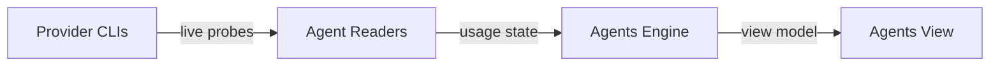

# Agents

Agents tracks provider subscriptions, capacity limits, and active CLI sessions inside the single Astrolabe application.

Data flow from provider CLI probes through live readers and the Agents engine to the interface.

## Components

Agents unites three parts inside the Astrolabe Rust workspace. Live data readers probe local provider CLIs and inspect active session metadata. The Agents module in `astrolabe-engines` aggregates quota windows and session status, and the Agents view draws capacity tables and indicators with widgets from `astrolabe-kit`.

## Provider Probes

Live readers query subscription limits across separate agent providers such as Claude, Codex, Gemini, and local models without a background daemon. Each probe collects available capacity, reset windows, and sign-in readiness directly when the view refreshes. Direct reads avoid stale caches and remove the need for a separate sync service.

## Capacity Views

The Agents view surfaces available capacity across subscriptions so the person can choose a provider or inspect active runs at a glance. Every meter, label, and status mark follows [UI Principles](../interface/ui-principles.md) with one color key across panes. Because Agents runs inside `astrolabe` alongside [Repos](repos.md), future views can tie token usage directly to repository work.

## Monitor Retirement

Agent Monitor moves its probe and quota engine into `astrolabe-engines` and its panels into `astrolabe`. Standalone Agent Monitor stays available only until parity and retires when Agents inside Astrolabe matches its capabilities.

## Limits

The table records current scope limits for the initial Agents integration.

| Area | Current Limit |
|---|---|
| Data collection | Live CLI probes and local session inspection only |
| History | In-memory snapshots without a persistent event log |
| Execution model | Direct reads inside `astrolabe` with no background daemon |
| Routing | Observation first while automated task routing follows in orchestration |
