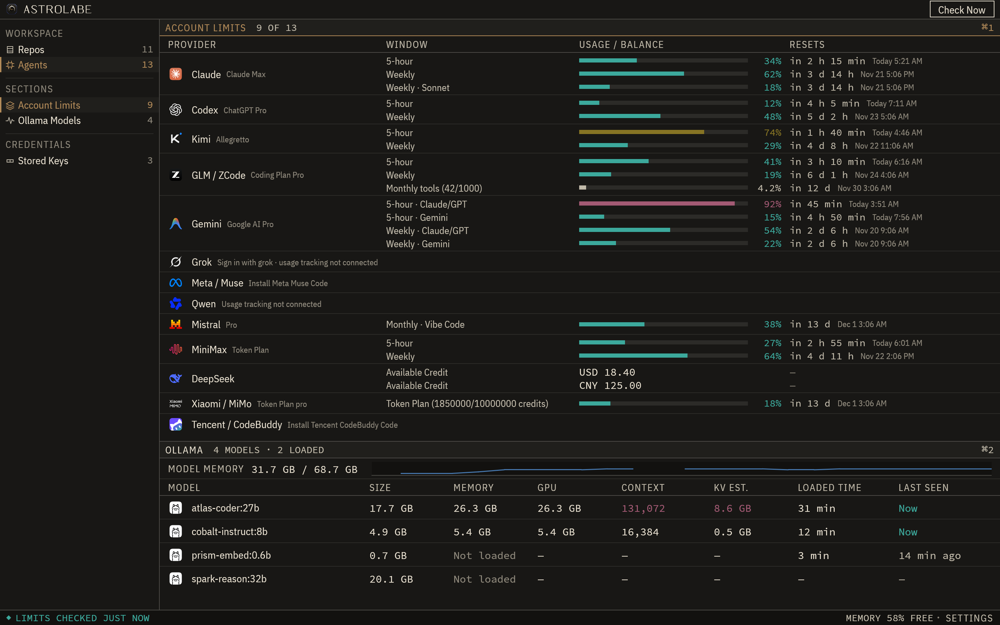

# Agents

Agents tracks provider quota windows, credit balances, local Ollama models, and macOS Keychain API keys inside the Astrolabe workstation.



The Agents panel shows the command bar, sidebar navigation, account limits table, Ollama memory monitor, and status bar.

## Commands

The Agents panel uses the shared Astrolabe shell with two vertically stacked workspace panes. The top pane shows `Account Limits` with a `<read> OF 13` count, and the lower pane shows `Ollama` with installed and loaded model counts. Sidebar items focus either pane or open the stored key modal.

| Area | Control | Action |
|---|---|---|
| Command Bar | `Check Now` | Wake all live sources whose last check occurred at least 30 seconds ago. |
| Sidebar Rail | `Account Limits`, `Ollama Models` | Focus the target pane and display active OK or installed counts. |
| Sidebar Rail | `Stored Keys` | Open the API Key Settings modal and display the stored key count. |
| Pane Header | `Account Limits` (`⌘1`), `Ollama` (`⌘2`) | Focus either tiled pane and inspect live counts. |
| Status Bar | `CHECKING LIMITS` or `LIMITS CHECKED` | Show active poll state or elapsed time after the newest check. |
| Status Bar | `MEMORY <free>% FREE` | Show macOS free memory percentage in normal, amber (15% to 29%), or red (below 15%) tone. |
| Status Bar | `PROBE FOLDER NOT EMPTY` | Warn when CLI probes leave unexpected files in the probe folder. |
| Status Bar | `Settings` | Open the API Key Settings modal for optional provider keys. |

## Provider Limits

The `Account Limits` pane lists all 13 non-Ollama providers in fixed `Provider::ALL` order. Each row shows a bundled logo or installed app icon, provider name, plan tier, usage windows or balances, and reset times. Absent credentials, uninstalled tools, or failed checks never display a zero-percent bar. Instead, the row shows status text beside the provider name, and pointer hover displays the full source note.

Each live provider runs on its own background thread with a fixed poll interval. Pseudo-terminal probes run inside an isolated empty probe folder and spend zero model tokens. Hosted API readers transmit credentials only to fixed official endpoints with HTTP redirects disabled.

| Provider | Source | Interval | Reported Data |
|---|---|---|---|
| `Claude` | Claude Code `/usage` in PTY (`--safe-mode`) | `120 s` | Plan tier, 5-hour and weekly windows, model-scoped windows. |
| `Codex` | Session files under `~/.codex/sessions` | `30 s` | Plan tier, primary 5-hour and secondary weekly windows. |
| `Kimi` | Kimi Code CLI `/usage` in PTY | `120 s` | Plan tier, 5-hour, weekly, or monthly windows. |
| `GLM / ZCode` | Z.ai quota API or ZCode sign-in | `120 s` | Plan tier, 5-hour and weekly windows, monthly tools count. |
| `Gemini` | Antigravity CLI (`agy`) `/usage` in PTY | `120 s` | Plan tier, scoped 5-hour and weekly windows (`Claude/GPT`, `Gemini`). |
| `Grok` | Grok CLI detection and sign-in check | `600 s` | Setup or unavailable status only. |
| `Meta / Muse` | Meta Muse Code CLI detection | `600 s` | Setup or unavailable status only. |
| `Qwen` | Qwen Code CLI detection | `600 s` | Setup or unavailable status only. |
| `Mistral` | Mistral budget API (Keychain, env, or `~/.vibe/.env`) | `120 s` | Plan tier and `Monthly · Vibe Code` budget usage. |
| `MiniMax` | MiniMax international Token Plan API | `120 s` | 5-hour or daily and weekly windows, scoped by model. |
| `DeepSeek` | DeepSeek account balance API | `120 s` | Explicit `USD` and `CNY` credit balances without bars. |
| `Xiaomi / MiMo` | Regional MiMo Token Plan API | `120 s` | Plan tier and credit allowance (`used/total credits`). |
| `Tencent / CodeBuddy` | CodeBuddy CLI or app detection | `600 s` | Setup or unavailable status only. |

## Usage and Resets

Model usage windows draw square bars with a right-aligned percentage and semantic colors from [UI Principles](../interface/ui-principles.md). Percentages below 10% keep one decimal digit when fractional, while all other values round to whole numbers. When a window passes its recorded reset timestamp before the next poll, the bar drops to `0%`.

Currency balances differ from quota windows because credit accounts carry no fixed denominator. DeepSeek renders one `Available Credit` row per currency (`USD` or `CNY`) with the exact balance and no progress bar. Positive balances appear in parchment, while zero balances switch to amber.

The `Resets` column shows relative countdowns beside local wall-clock times, such as `in 2 h 15 min Today 5:21 AM`. Expired windows display `Reset Since Reading`, while balance rows and fixed-term plans display `—`.

| Indicator | Threshold or Rule | Visual Tone |
|---|---|---|
| Normal Quota Bar | Used percentage below `70%` | `OK` (green). |
| Caution Quota Bar | Used percentage from `70%` to `89%` | `WARN` (amber). |
| Critical Quota Bar | Used percentage at or above `90%` | `ERROR` (red). |
| Tool Window Bar | Window name contains ` tools` (excluded from peak usage) | `Neutral` (secondary gray). |
| Currency Balance | Positive credit amount with no bar | `Parchment` text, `WARN` at `0.00`. |
| Reset Countdown | Future timestamp (`now`, `in M min`, `in H h M min`, `in D d H h`) | Secondary countdown with faint local clock. |

## Fields

The `Ollama` pane polls `http://127.0.0.1:11434` every 5 seconds through `/api/ps` and `/api/tags`. It also queries `/api/show` one time per model to compute KV cache bytes per token in 16-bit precision from attention metadata. The top `Model Memory` band shows loaded memory against physical RAM beside a 10-minute sparkline of up to 121 samples. Failed polls record empty samples, and sleep gaps over three poll intervals break the sparkline rather than bridge absent samples.

Installed models appear in a sorted table with loaded models first and alphabetical order within each group. Pointer hover shows family, parameter count, quantization, GPU footprint, KV cache estimate, unload countdown, and session peak memory. Large contexts or KV caches highlight both `Context` and `KV Est.` cells. Amber starts at `65,536` tokens or `8.0 GB`, and red starts at `131,072` tokens or `16.0 GB`.

| Column | Unit or Format | Meaning |
|---|---|---|
| `Model` | Model tag | Installed or loaded model name with Ollama icon. |
| `Size` | `GB` | Model weight file size on disk from `/api/tags`. |
| `Memory` | `GB` or `Not loaded` | Resident memory reported by Ollama `/api/ps`. |
| `GPU` | `GB` or `—` | Resident VRAM portion, capped at `Memory`. |
| `Context` | Token count | Active context length, colored by alert threshold. |
| `KV Est.` | `GB` | Estimated 16-bit KV cache (`kv_per_token * context`), colored by threshold. |
| `Loaded Time` | `s`, `min`, or `h min` | Cumulative observed session residency without failed polls or sleep gaps. |
| `Last Seen` | `Now` or relative age | Green `Now` while loaded, or elapsed age after the last observed load. |

## Keychain Settings

The API Key Settings modal manages optional credentials for five hosted providers. Astrolabe stores keys only under the `Astrolabe` service in the macOS login Keychain. When a key is absent under `Astrolabe`, Astrolabe imports a standalone agent key once into `Astrolabe` if one is present. Astrolabe leaves the earlier Keychain item unchanged. Each provider worker caches its first Keychain read in private memory. As a result, periodic polls do not cause repeated macOS access prompts.

The modal displays a `Key Stored` or `No Key` chip and masks characters in a password field. Any provider change or modal close clears unsaved input. `Save` commits a non-empty key, `Remove` deletes the stored entry, and `Close` exits without changes. Every explicit save or removal increments a cache revision and discards stale poll results.

| Provider | Keychain Account | Override Scope | Extra Field |
|---|---|---|---|
| `GLM / ZCode` | `glm-coding-plan` | Overrides ZCode sign-in credentials | None. |
| `Mistral` | `mistral-api` | Overrides `MISTRAL_API_KEY` and `~/.vibe/.env` | None. |
| `MiniMax` | `minimax-api` | Overrides international `MINIMAX_API_KEY` | None. |
| `DeepSeek` | `deepseek-api` | Overrides `DEEPSEEK_API_KEY` | None. |
| `Xiaomi / MiMo` | `xiaomi-token-plan` | Overrides MiMo Code auth (`tp-` key) | `Region` (`China`, `Europe`, `Singapore`). |

Xiaomi / MiMo stores the selected region and API key together as one Keychain JSON record. Thus a regional key always routes to its chosen gateway.

## Demo Mode

Start Astrolabe with `--demo --panel agents` to open the Agents panel directly with deterministic fixture data. Demo mode can also start from `astrolabe --demo` after a click on `Agents` in the sidebar.

```bash
astrolabe --demo --panel agents
```

Demo mode loads all 13 providers at a fixed timestamp through `Engine::fixed`. Nine providers show windows or balances across green, amber, red, and neutral bars plus DeepSeek `USD` and `CNY` credit rows. The other four rows cover `Setup`, `NotInstalled`, and `Unavailable` states.

The Ollama pane holds four synthetic models with two loaded, a red `131,072` context highlight, and a 10-minute sparkline with one gap. Demo mode performs zero CLI probes, network calls, or Keychain reads, and Settings actions update only in-memory state.
