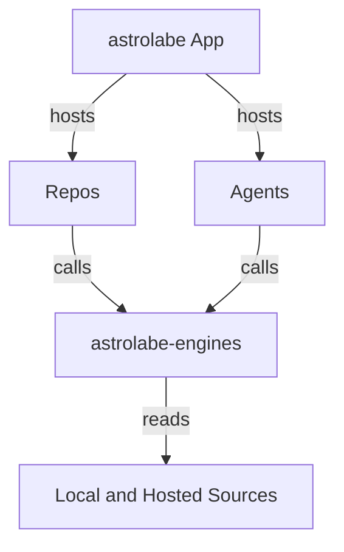

# Apps

Apps are built-in workspaces inside the Astrolabe desktop application, powered by `astrolabe-engines` and styled with `astrolabe-kit`.

Built-in workspaces inside Astrolabe share one shell, engine crate, and live data architecture.

## Built-In Workspaces

Astrolabe ships with two integrated workspaces accessible from the top of the sidebar rail. [Repos](repos.md) monitors local Git repositories, branches, worktrees, smart folders, **Watched Folders**, and **Repository Location** (`Local Only`, `Remote Only`, and `Both`). [Agents](agents.md) monitors provider quota windows, credit balances, local Ollama model memory, and macOS Keychain API keys.

Each workspace follows the visual and interaction rules in [UI Principles](../interface/ui-principles.md). Consistent shortcuts, tables, status chips, and inspectors let the user switch between code state and agent capacity inside one window.

## Shared Context

Both workspaces run concurrently inside one native Rust binary while background threads keep snapshots fresh. When the user switches between Repos and Agents, Astrolabe preserves active filters, selection state, and live background polls with zero reload delay.
