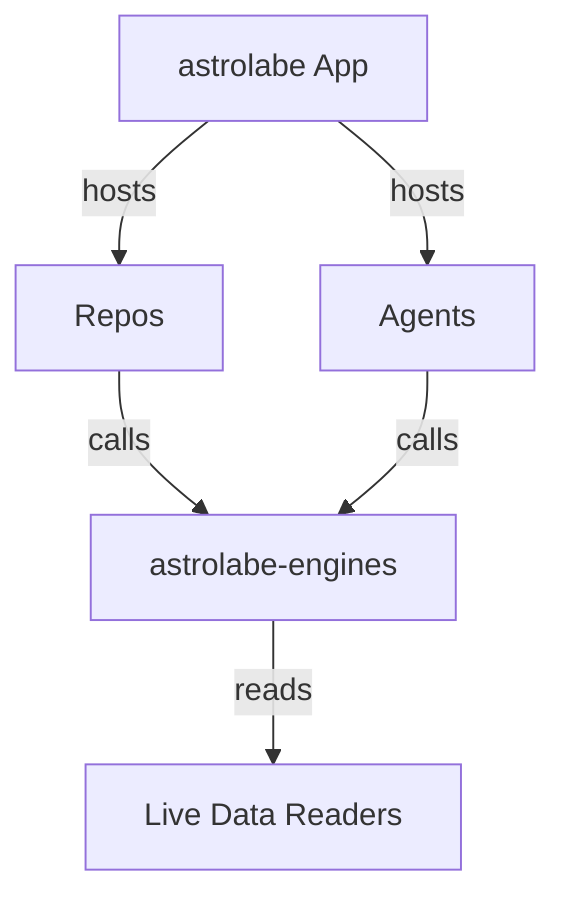

# Apps

Apps are specialized workspaces inside the single Astrolabe application, backed by `astrolabe-engines` and `astrolabe-kit`.

Built-in apps inside Astrolabe share one engine crate and live data readers.

## Monitor Consolidation

Astrolabe absorbs the engines of Repo Monitor and Agent Monitor as built-in apps. [Repos](repos.md) tracks local Git repositories, branches, and worktrees inside the host window. [Agents](agents.md) tracks provider subscriptions, rate limits, and active sessions across CLI tools. Standalone Repo Monitor and Agent Monitor retire when Astrolabe matches their features.

## Workspace Integration

When both apps run inside one Rust binary, views share context without a separate protocol layer or daemon. Later views can connect an agent session, its token budget, its repository, and its commits directly in memory.
