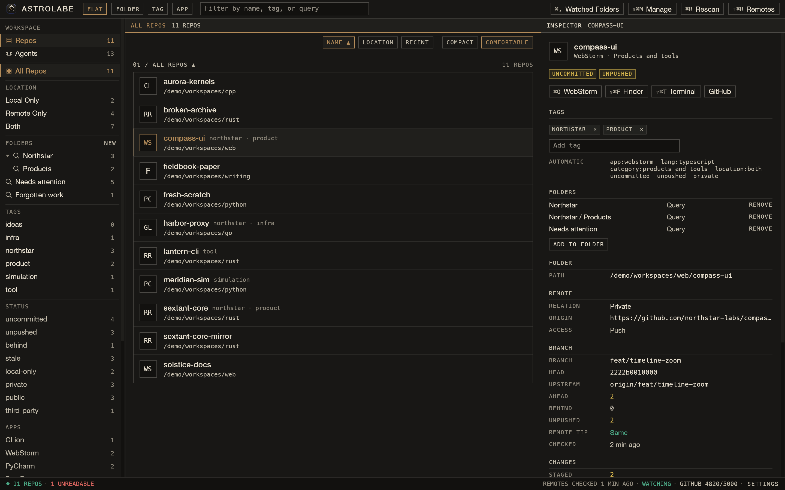
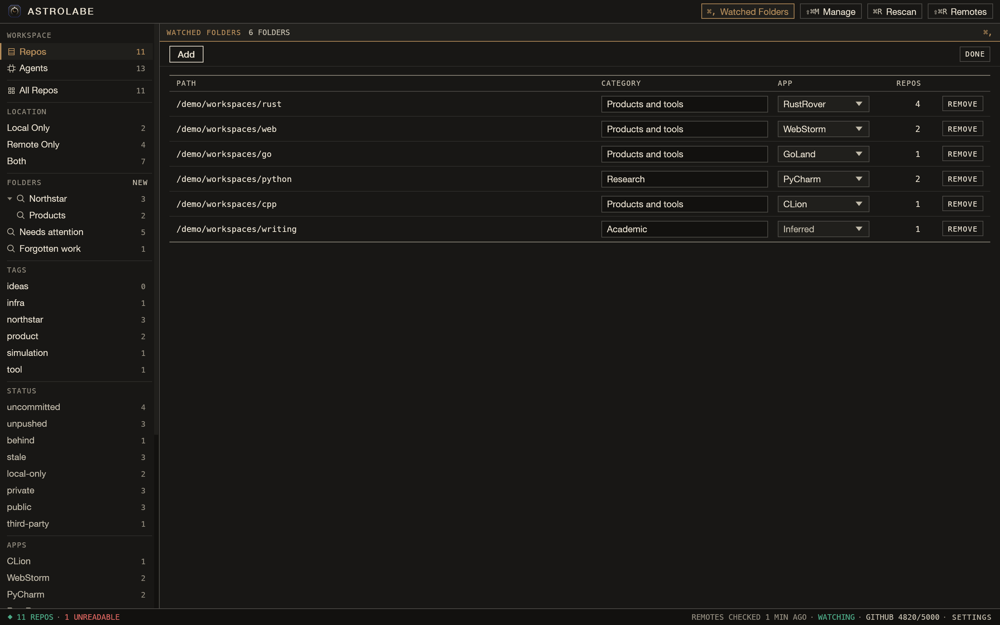
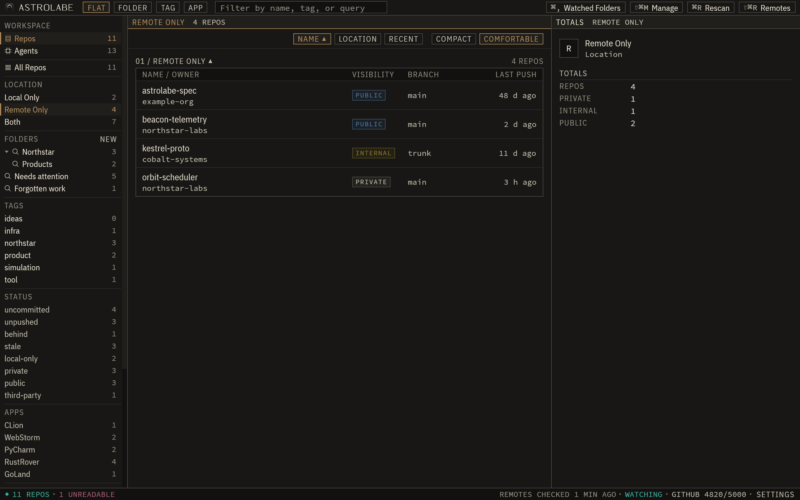

# Repos

Repos inspects local Git repositories, branches, worktrees, smart folders, **Watched Folders**, and **Repository Location** inside the Astrolabe workstation.



The Repos panel shows the command bar, contextual sidebar, repository list, inspector pane, and live status bar.

## Commands

The Repos panel contains four workspace regions: a command bar, a sidebar rail, a list pane, and an inspector pane. A persistent status bar sits along the bottom edge. Each region provides focused controls for repository discovery, navigation, and organization.

| Area | Control | Action |
|---|---|---|
| Command Bar | `Flat`, `Folder`, `Tag`, `App` | Switch list sections (`⌘1` to `⌘4`). |
| Command Bar | Filter field | Filter rows with boolean syntax (`⌘F`). |
| Command Bar | `Save As Smart Folder` | Create a smart folder from a valid filter (`⇧⌘N`). |
| Command Bar | `Watched Folders` | Toggle the Watched Folders view (`⌘,`). |
| Command Bar | `Manage`, `Rescan`, `Remotes` | Toggle Manage mode (`⇧⌘M`), rescan (`⌘R`), or check remotes (`⇧⌘R`). |
| Sidebar Rail | `All Repos`, `Folders`, `Tags` | Choose scope, nest folders, or drop rows to pin or tag. |
| Sidebar Rail | `Location` | Filter repositories by `Local Only`, `Remote Only`, or `Both`. |
| Sidebar Rail | `Status`, `Apps`, `Languages`, `Categories` | Filter visible repositories by automatic tags. |
| List Strip | `Add Query` or query field | Edit a folder rule with 800 ms debounced save to `organize.toml`. |
| List Strip | `Name`, `Location`, `Recent` | Sort visible rows and flip order on repeat clicks. |
| List Strip | `Compact`, `Comfortable` | Switch between 34 px single-line and 52 px two-line rows. |
| Status Bar | Left telemetry | Show repository count, active reads, checks, unreadable paths, or errors. |
| Status Bar | Right telemetry and `Settings` | Show remote check age, watcher state, GitHub quota, and open settings folder. |

Each list row displays an IDE icon or two-letter monogram, repository name, manual tags, and tilde-shortened path. A double click opens the repository in its assigned IDE. A right click opens actions for the IDE, Finder, Terminal, GitHub, folders, tags, and removal of unreadable entries.

Manage mode switches the workspace panes into a dedicated folder and tag editor. The Folders tab supports folder creation, inline rename, drag-and-drop reorder across before, into, and after zones, and a `Move To` menu. Its editor shows live query match counts, pinned and excluded lists, and a searchable `Add Repos` checklist. The Tags tab supports tag creation, rename or merge onto another tag, deletion, and bulk tag or untag actions.

## Watched Folders



The Watched Folders view manages the root folders configured in `~/Library/Application Support/Astrolabe/config.toml`. Click `Watched Folders` in the command bar or press `⌘,` to toggle the pane.

Each table row displays the folder path, assigned category, IDE app (`Inferred` or a specific IDE), discovered repository count, and a `Remove` button. Click `Add` to pick a new root folder through the macOS folder dialog, or edit category and app fields inline. Click `Remove` to drop a root folder from `config.toml`, and Repos leaves files on disk unchanged. Every change saves automatically and starts a rescan of configured roots.

On first launch, Astrolabe imports watched folders and skip rules if an existing repository settings file is present. Astrolabe leaves the source file untouched and writes its own `config.toml` under `~/Library/Application Support/Astrolabe/`.

## Repository Location



The `Location` section sits directly below `All Repos` in the sidebar rail and tracks where each repository exists. Three live filters divide the workspace into `Local Only`, `Remote Only`, and `Both` with automatic `location:<scope>` tags and counts.

`Local Only` shows local Git repositories that have no configured remote. `Both` shows local repositories backed by a remote such as GitHub. `Remote Only` lists repositories from the authenticated GitHub account that have no local clone on disk. Remote-only entries appear in read-only rows with repository name, owner, visibility, default branch, and last push time.

## Group Modes

Four group modes organize visible rows into numbered framed sections inside the list pane. Each section header displays a sequence number, an uppercase title, and a repository count. When a repository belongs to multiple folders or carries multiple manual tags, Repos displays it in each section.

| Mode | Shortcut | Section Rule |
|---|---|---|
| `Flat` | `⌘1` | One section for the active sidebar scope. |
| `Folder` | `⌘2` | One section per top-level folder or child subfolder, plus `Not in a folder` or `Not in a subfolder`. |
| `Tag` | `⌘3` | One section per manual tag, plus `No tags`. |
| `App` | `⌘4` | One section per IDE (`CLion`, `WebStorm`, `PyCharm`, `RustRover`, `GoLand`), plus `No app`. |

Sort controls order rows inside every section by name, path location, or newest commit time. The `Recent` sort places the newest commit first on the initial click, while `Name` and `Location` sort from A to Z. A second click on the active sort button flips the order. Density controls switch between `Compact` single-line rows and `Comfortable` two-line rows.

## Query Syntax

The top filter field and smart folder rules share one boolean query grammar. Text match is case-insensitive, and an empty query matches all repositories. Operator precedence runs from highest to lowest: parentheses, negation, conjunction, and disjunction. Parse errors display inline red feedback beside the field.

| Construct | Syntax | Behavior |
|---|---|---|
| Parentheses | `(a OR b)` | Group expressions to override default operator precedence. |
| Negation | `NOT x`, `-x` | Invert the match of the next term or group. |
| Conjunction | `a AND b`, `a && b`, `a b` | Match repositories that satisfy both terms. |
| Disjunction | `a OR b`, `a | b`, `a || b` | Match repositories that satisfy either term. |
| Bare Word | `northstar`, `"my repo"` | Match a known tag, or else match repository name or path. |
| Tag Field | `tag:value`, `tag:"two words"` | Match a manual or automatic tag after lowercase hyphen normalization. |
| Name Field | `name:value` | Match a substring inside the repository folder name. |
| Path Field | `path:value` | Match a substring inside the tilde-shortened repository path. |

Repos generates automatic tags directly from repository metadata without manual upkeep. Eight status tags record repository state: `uncommitted`, `unpushed`, `behind`, `stale`, `local-only`, `private`, `public`, and `third-party`. A repository receives `stale` when its latest commit is older than 30 days.

Four prefixed tag families capture tool, location, and project facts: `app:<ide>`, `lang:<language>`, `category:<slug>`, and `location:<scope>`. Repos detects languages from top-level project marker files or file extensions at the root and inside `src/`. Manual tags cannot reuse automatic tag names.

## Fields

The right pane switches between `Totals` and `Inspector` views based on row selection. When no repository holds selection, the pane shows `Totals` for the active sidebar scope and filter. Clickable attention chips at the top append `local-only`, `uncommitted`, `unpushed`, or `behind` to the filter. When a folder is active, `Totals` also displays its query, pinned entries, and excluded entries with `Remove` and `Restore` controls.

When a repository holds selection, the pane displays the `Inspector` view. Its header shows the icon, repository name, assigned IDE, category, status chips, and launch buttons for the IDE, Finder, Terminal, and GitHub. Conditional sections appear only when stashes, linked worktrees, submodules, or sibling copies exist.

| View | Section | Fields |
|---|---|---|
| `Totals` | `Totals` | `Repos`, `Local Only`, `Private`, `Public`, `Other Hosts`, `Uncommitted`, `Unpushed`, `Behind`, `Stale`, `7 Days`, `30 Days`. |
| `Totals` | `By App` | Repository counts per IDE and `No App` when more than one group exists. |
| `Totals` | `Stalest Uncommitted` | Up to 8 oldest dirty repositories with age and click-to-select rows. |
| `Inspector` | `Tags` | Removable manual tag chips, `Add tag` input with up to 8 suggestions, and `Automatic` tags. |
| `Inspector` | `Folders` | Parent folders marked `Pinned` or `Query` with `Remove` action, plus `Add to Folder` menu. |
| `Inspector` | `Folder` | Tilde-shortened `Path`, plus error detail and `Remove From Monitor` when unreadable. |
| `Inspector` | `Remote` | `Relation`, remote fetch URLs, and GitHub `Access`, `Archived`, and `Fork` metadata. |
| `Inspector` | `Branch` | `Branch` or `Detached HEAD`, 12-character `Head` SHA, `Upstream`, `Ahead`, `Behind`, `Unpushed`, `Remote Tip`, `Checked`. |
| `Inspector` | `Changes` | `Staged`, `Unstaged`, `Untracked`, `Conflicted` (when nonzero), and `Oldest Change` timestamp. |
| `Inspector` | `Commits` | `Total`, `7 Days`, `30 Days`, `Last` 7-character SHA and age, `Commit Date`, `Author Date`, subject. |
| `Inspector` | `Stashes` | Stash index (`stash@{n}`), age, and subject when stashes exist. |
| `Inspector` | `Worktrees` | Linked worktree name, branch or detached SHA, and dirty or absent state. |
| `Inspector` | `Submodules` | Submodule path, state (`Current`, `Moved`, `Not Initialized`, `Conflict`), and dirty marker. |
| `Inspector` | `Copies` | Sibling checkouts with shared root commits, branch, commit divergence, and click-to-select link. |

## Status Flags

Repos evaluates every read repository into ordered status flags with the most urgent state first. Each flag maps to one semantic tone from [UI Principles](../interface/ui-principles.md). A repository that reads cleanly with no attention flags receives `IN SYNC`.

| Flag | Tone | Condition |
|---|---|---|
| `UNREADABLE` | `Error` | Git fails to read repository metadata. |
| `LOCAL ONLY` | `Error` | Repository has no configured remote. |
| `NOT ON REMOTE` | `Error` | Remote check reports the upstream branch absent on the remote. |
| `UNCOMMITTED` | `Warn` | Main worktree or any linked worktree holds uncommitted paths. |
| `UNPUSHED` | `Warn` | `HEAD` holds commits absent from any remote ref on a remote repository. |
| `BEHIND` | `Info` | Local upstream ref holds commits absent from `HEAD`. |
| `REMOTE MOVED` | `Info` | `git ls-remote` reports a newer remote tip than the last fetch. |
| `IN SYNC` | `Ok` | Successful read with none of the flags above. |

## Keys

Keyboard shortcuts operate across the Repos panel while no modal dialog holds focus. Selection and launch shortcuts act on the highlighted repository row. `Escape` closes the active subview, clears focus, deselects a row, or clears the top filter.

| Key | Scope | Action |
|---|---|---|
| `⌘1` to `⌘4` | Panel | Switch group mode (`Flat`, `Folder`, `Tag`, `App`). |
| `⌘F` | Panel | Focus the filter field. |
| `⌘R` | Panel | Rescan configured roots. |
| `⇧⌘R` | Panel | Check remote tips with `git ls-remote`. |
| `⌘,` | Panel | Toggle the Watched Folders view. |
| `⇧⌘M` | Panel | Toggle Manage mode. |
| `⌘N` | Panel | Open the New Folder dialog. |
| `⇧⌘N` | Panel | Open the New Smart Folder dialog from the active filter. |
| `⌘O`, `Return` | Selected row | Open the selected repository in its IDE. |
| `⇧⌘F` | Selected row | Reveal the selected repository in Finder. |
| `⇧⌘T` | Selected row | Open the selected repository in Terminal. |
| `⌘T` | Selected row | Focus `Add tag` for the selected repository. |
| `Up`, `Down` | List | Move row selection across visible sections. |
| `Escape` | Context | Close Watched Folders, Manage mode, or Add Repos, deselect, or clear filter. |

## Demo Mode

Start Astrolabe with `--demo` to open the Repos panel with synthetic data. Pass `--panel repos` to select Repos explicitly, because Repos is also the default panel.

```bash
astrolabe --demo --panel repos
```

Demo mode loads 11 deterministic repositories under `/demo/workspaces/` at a fixed timestamp and starts an idle engine. The fixture covers all eight status flags, smart folders, nested subfolders, manual tags, stashes, a worktree, a submodule, sibling copies, and an unreadable entry. Demo mode keeps all edits in memory and performs zero reads or writes against real repositories, configuration files, external apps, or the network.
