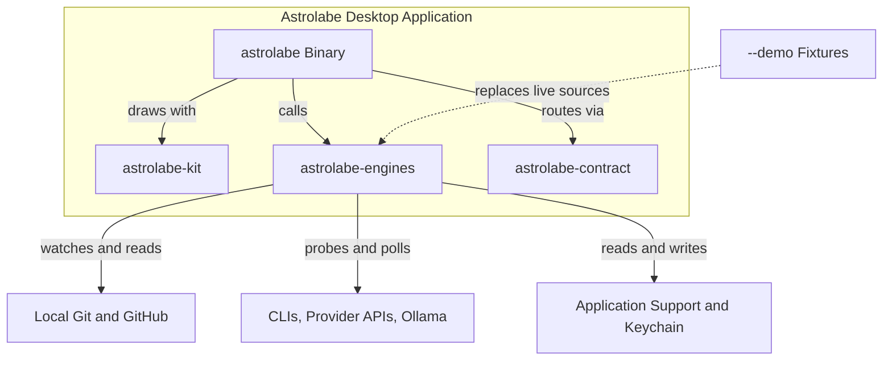
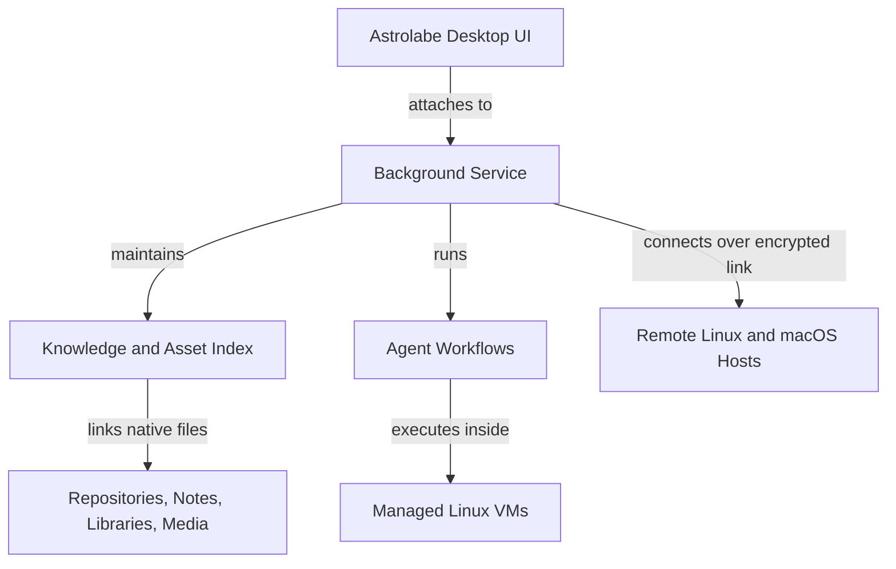

# Astrolabe Architecture

Astrolabe runs as one native macOS desktop application in Rust, built on `eframe`, `egui`, a shared UI kit, and decoupled background engines.

Current runtime architecture of the Astrolabe crates, live sources, local storage, and deterministic demo mode.

## Workspace Crates

Four Cargo crates separate window ownership, visual widgets, domain engines, and tool contracts. Each crate carries a single responsibility with strict dependency boundaries.

| Crate | Role | Key Types and Modules |
|---|---|---|
| `astrolabe` | Native macOS desktop application (`eframe` and `egui`) | `AstrolabeApp`, `LaunchOptions`, `Host`, `repos_panel`, `agents_panel` |
| `astrolabe-kit` | Shared UI kit and offscreen snapshot helpers | `tokens`, `theme`, `layout`, `chrome`, `data`, `draw`, `capture` |
| `astrolabe-engines` | Headless domain engines with zero UI dependencies | `repos::Engine`, `agents::Engine`, `query`, `tags`, `watch`, `keychain` |
| `astrolabe-contract` | Shared tool and item contract definitions | `Tool`, `CommandSpec`, `Effect`, `Actor`, `Invocation`, `Outcome`, `ItemRef` |

The `astrolabe` binary owns the native window (`1440 x 900` default and `1180 x 640` minimum), top command bar, sidebar navigation, status bar, and panels. It mounts both [Repos](../apps/repos.md) and [Agents](../apps/agents.md) inside one process and holds an in-process `Host` command router.

The `astrolabe-kit` crate implements the visual system defined in [UI Principles](../interface/ui-principles.md). It provides the mineral dark palette, typography tokens, shell chrome, tables, summary metric tiles, status chips, usage bars, and pure layout geometry. Its optional `capture` feature drives headless `egui_kittest` and `wgpu` rendering for offscreen PNG snapshots.

The `astrolabe-engines` crate holds all domain logic and depends on zero `egui` or `eframe` crates. Its `repos` module runs filesystem watchers, Git readers, GitHub checks, boolean queries, automatic tags, and smart folder rules. Its `agents` module runs tool discovery, CLI pseudo-terminal probes, hosted HTTP quota readers, and Ollama memory polls.

The `astrolabe-contract` crate defines a uniform interface for interactive tools and automation. Each `Tool` publishes a command catalog with JSON Schema inputs and outputs, an `Effect` class (`Read`, `Write`, `Destructive`, or `External`), structured inspection, render support, and stable `astrolabe://<tool>/<kind>/<id>` references.

## Live Data Flow

All filesystem, Git, subprocess, and network operations run on background worker threads off the UI thread. Workers deliver immutable updates and trigger UI repaints, and never block input or frame rendering.

In the repository engine, one coordinator thread owns settings, root discovery, and the `notify` filesystem watcher. Four Git reader threads inspect local checkouts, three checker threads run `git ls-remote`, and one GitHub thread refreshes remote metadata. The coordinator pushes typed `Msg` values over an `mpsc` channel and wakes the UI frame loop.

In the agent engine, each live provider runs on its own background thread on a fixed interval. Codex session files refresh every 30 seconds, CLI probes and hosted APIs refresh every 120 seconds, and tool discovery runs every 600 seconds. Local Ollama memory and model checks poll `http://127.0.0.1:11434` every 5 seconds.

Each agent worker writes into one mutex-guarded `Shared` snapshot and notifies the UI to repaint. A manual `Check Now` request wakes eligible workers while a 30-second minimum gap prevents rapid repeat polls.

## Deterministic Demo Mode

Start Astrolabe with `--demo` to replace every live worker with deterministic in-memory fixtures anchored at fixed timestamps. Optional `--panel repos` or `--panel agents` flags open the requested panel immediately.

In demo mode, Repos starts an idle engine with 11 synthetic repositories under `/demo/workspaces/`. Agents starts a fixed engine with 13 synthetic providers and 4 local Ollama models. Demo mode keeps all edits in memory and performs zero reads or writes against real repositories, configuration files, Keychain entries, CLIs, or network endpoints. As a result, contributors run repeatable visual reviews, screenshots, and offscreen tests.

## Local Settings and Credentials

Astrolabe stores plain TOML configuration and view state under `~/Library/Application Support/Astrolabe/`. Three files keep responsibilities clear: `config.toml` holds watched folders and skip rules, `organize.toml` holds manual folders and tags, and `window.toml` holds active panel preferences. Local caches live under `~/Library/Caches/astrolabe/`.

Agent support files live under `~/Library/Application Support/Astrolabe/agents`, and agent caches live under `~/Library/Caches/astrolabe/agents`. CLI probes run inside an empty probe folder at `~/Library/Application Support/Astrolabe/agents/probe` that stays isolated from project repositories. If a probe leaves unexpected files in that folder, the status bar shows a warning.

Provider API keys use the `Astrolabe` service in the macOS login Keychain and never enter TOML files. Each provider worker caches its first Keychain lookup in private memory. Thus periodic polls do not cause repeated macOS access dialogs.

## Planned Architecture

Astrolabe grows from the single desktop binary into a local service architecture that keeps observation, index updates, and agent execution active beyond one window.

Planned service architecture across the desktop UI, background daemon, local index, workflows, managed VMs, and remote hosts.

### Background Service

A local background daemon maintains filesystem watchers, index updates, and active agent runs independently of the desktop window. When the user closes the window, watchers and active runs stay active. When the user reopens Astrolabe, the UI attaches directly to live daemon state without cold restarts.

### Knowledge and Asset Index

A rebuildable local SQLite and full-text index connects repositories, notes, reference libraries, and media assets across specialized applications. Source files stay in their native tools and folders on disk. Stable `ItemRef` addresses link related items across views, and removal of the index never risks primary user files.

### Agent Workflows

Structured multi-step workflows run agents with scoped context, automated verification checks, and explicit human review gates. Every workflow action calls named commands through the `astrolabe-contract` boundary with full actor attribution. Automated checks collect test output, diffs, or rendered captures as evidence, and external or destructive actions wait for human approval.

### Managed Linux VMs

Isolated Linux virtual machines give agent workflows dedicated environments for builds, command tools, and browsers. Each virtual machine enforces explicit CPU, memory, and disk budgets. When a workflow finishes, the environment resets or shuts down cleanly and returns host capacity.

### Remote Hosts

Encrypted connections to remote Linux and macOS machines bring remote repositories, models, and agent runs into one workspace. The desktop UI observes remote hosts beside local resources with the same status semantics, quota views, and workflow controls.

## Design Decisions

**Decoupled engines and UI.** Because `astrolabe-engines` holds zero graphics or widget crates, unit tests verify all Git, query, and quota logic directly. The same crate boundary lets engines move into the planned background service with no reader rewrite.

**Non-blocking snapshots.** All disk, Git, PTY, and HTTP operations run on background threads, and desktop rendering stays smooth at every scale. The UI reads snapshots and dispatches asynchronous commands, and never blocks frames.

**Deterministic test fixtures.** Fixed-timestamp demo snapshots and headless `wgpu` rendering allow automated layout checks and visual captures without real repositories or network state.

**Approval gates for risk.** Any automated command classified as `Destructive` or `External` in `astrolabe-contract` pauses at a human approval gate before execution.
