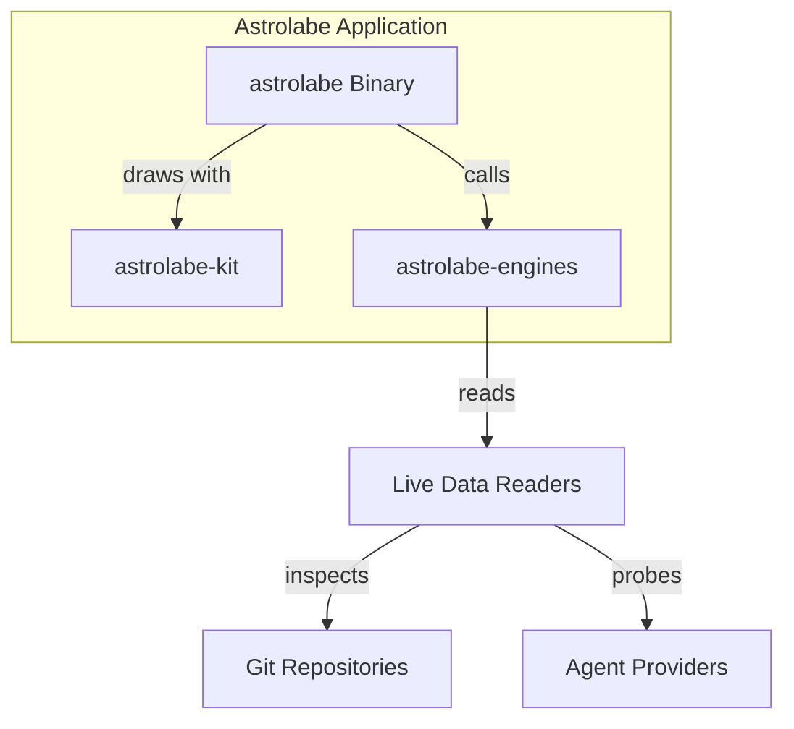
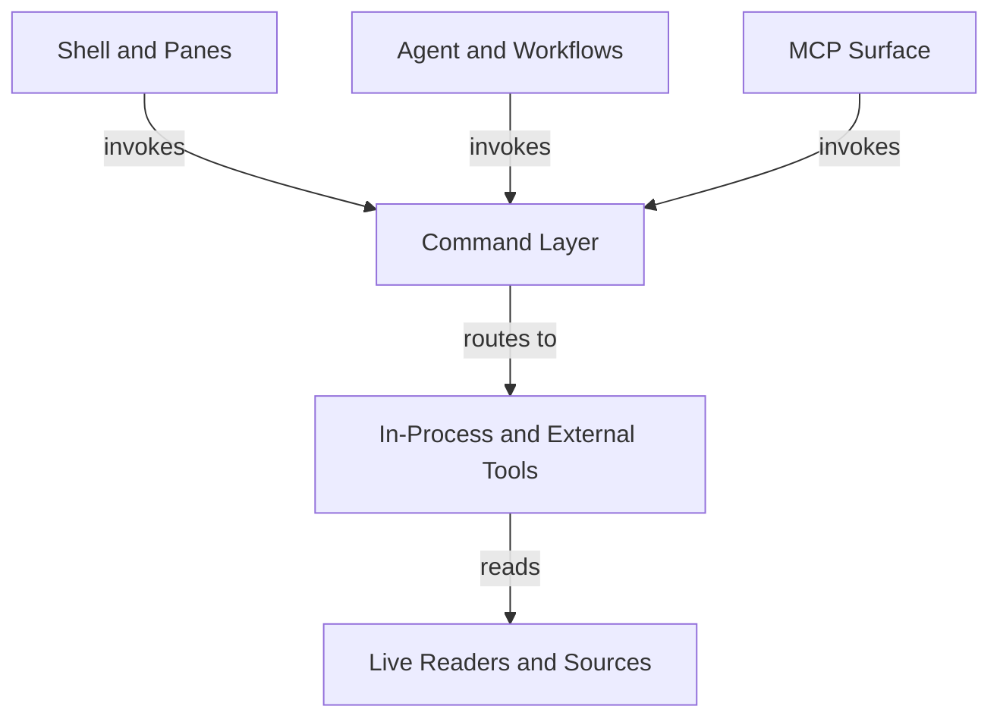

# Astrolabe Architecture

Astrolabe runs as one Rust application built on live data readers, engines in `astrolabe-engines`, and UI widgets in `astrolabe-kit`.

Current architecture of the single Astrolabe Rust application, its crates, and its live data readers.

## Components

The table lists the core parts of the current Astrolabe architecture.

| Component | Responsibility |
|---|---|
| `astrolabe` | Single Rust desktop application that owns the window, navigation, and built-in app views |
| `astrolabe-kit` | Shared UI widgets, Sternbild theme tokens, layout primitives, and reusable controls |
| `astrolabe-engines` | Domain engines migrated from Repo Monitor and Agent Monitor |
| Live data readers | Direct on-demand readers for local Git repositories, files, and provider CLI probes |
| `astrolabe-contract` | Early command, inspection, and rendering trait prototype for later tool integration |

Astrolabe is the single application now. One Rust executable hosts both the [Repos](../apps/repos.md) and [Agents](../apps/agents.md) views in one process. Thus state and navigation stay direct. Shared interface elements live in `astrolabe-kit` under [UI Principles](../interface/ui-principles.md).

## Monitor Consolidation

The monitors move their engines into `astrolabe-engines`, and their views move into `astrolabe`. Standalone Repo Monitor and standalone Agent Monitor retire when Astrolabe matches their capabilities. One application removes duplicate themes, shells, and probe code. Future views can also link repositories directly to agent sessions.

## Deferred Infrastructure

Persistence, record IDs, event logs, protocol crates, and a daemon are added only when a feature needs them. The current build reads live data directly from local Git checkouts, configuration files, and provider CLI probes without a database or background service.

This restraint keeps the codebase small while monitor consolidation proceeds. When a concrete feature needs SQLite indexes, stable `astrolabe://<tool>/<kind>/<id>` record IDs, or an event log, that piece enters the workspace. The same rule applies to protocol crates and a background daemon.

## Layer Model

[Product Direction](../introduction/direction.md#layer-model) organizes the wider system into five layers: environments, orchestration, interfaces, workflows, and an optional backbone. The single Rust application anchors the interfaces layer today and grows into the local host shown below as later features arrive.

Target local host capabilities that build on top of the consolidated Rust application.

Artisan and Alchemist VMs supply desktop environments outside the local host. Loggia supplies the internal Astrolabe installation and drives orchestration requirements. The shared Sternbild backend handles optional accounts, sync, licensing, and billing while local work stays independent of network availability.

## Agent Loop and Contract

Future agent automation inside Astrolabe follows one closed loop across tools and interfaces.

### Agent Loop

Every agent action follows four steps in order:

1. Act through a named command.
2. Inspect structured state from the target tool.
3. Render the output as an image, page, or export.
4. Compare the rendered output with the goal and repeat until complete.

Verification stays inside the loop. Thus every claim carries visible evidence. The person can watch the timeline, pause execution, take over, or undo reversible actions.

### Tool Contract

The `astrolabe-contract` crate prototypes the interface for tools that join the command layer when that capability is needed. A tool exposes a named command catalog with JSON Schema inputs and outputs, an effect classification (`Read`, `Write`, `Destructive`, or `External`), structured inspection, rendering, and stable item references.

Buttons in the interface and agent invocations call the same commands, and no agent action stays hidden. Destructive or external commands initiated by an agent or workflow pause at an approval gate until the person approves them.

### Workflows

A workflow combines a spec, rules and checks, evidence, and history under one definition. That definition runs locally, on hosted capacity, in parallel, or for a team. Saved command chains with named inputs can trigger updates when source inputs change, and they use the same approval gates and actor attribution as agents. The declared workflow format remains an open decision.

### MCP Surface

When external agent control is added, the host exposes its command catalog, inspection calls, and rendering calls through an MCP server. Outside agents such as Claude Code and Codex then drive tools through the same boundary as built-in agents without per-agent adapters.

## Caliper Integration

The table places Astrolabe alongside related Sternbild projects.

| Project | Role | Stack |
|---|---|---|
| Astrolabe | Single productivity application across five layers | Rust |
| Caliper | Machine-learning instrument | C++ with ImGui, Metal, and Vulkan |
| Alidade | Learning platform | Web |
| Compass | Practice platform | Web |
| Constellation | Organization knowledge base | To be decided |

Caliper stays a standalone C++ product because it relies on LibTorch and zero-copy GPU memory access. Astrolabe embeds Caliper views inside a pane through `libcaliper` (Caliper Embed) and can expose Caliper commands through a thin adapter when cross-tool orchestration needs them.

## Design Decisions

**Single application first.** Direct consolidation of Repo Monitor and Agent Monitor into `astrolabe` delivers one workspace now. This choice avoids parallel standalone apps and a long contract phase.

**Live readers before persistence.** Direct reads of Git state and provider quotas keep the current architecture fast and simple. Persistence, record IDs, event logs, protocol crates, and a daemon stay deferred until a feature needs them.

**Rust for core crates.** Rust gives strong compile-time verification across `astrolabe`, `astrolabe-kit`, and `astrolabe-engines`, which matters when agents generate and modify much of the code.

**Approval gates for risk.** Any automated command with a destructive or external effect waits for explicit human approval before execution.

## Open Decisions

Six design questions stay open until future features force a choice:

- **Falcon integration:** Extract shared library, PDF, and media crates while Falcon stays standalone, or make Falcon a built-in Astrolabe library tool.
- **Rich reading panes:** Choose between native views, Falcon PDF crates, or a contained web view for long-form reading and editing alongside instrument-style panes.
- **Shared backend name:** Select a distinct name for the shared backend service so it does not collide with the Alidade learning platform.
- **Out-of-process transport:** Confirm JSON over a local socket when the first non-Rust tool attaches to the host.
- **Workflow format:** Define the declared format that carries specs, rules, checks, evidence, and history across environments and scales.
- **Host license:** Finalize the license model for the Astrolabe host under internal commercial strategy.
