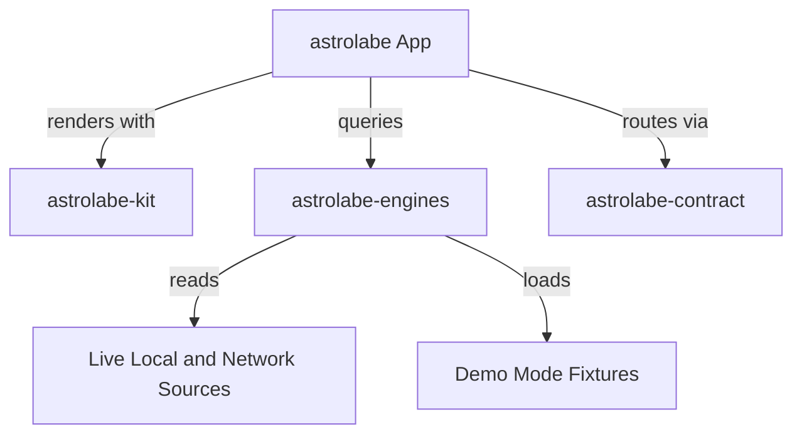

# Architecture

Astrolabe runs as one native macOS application in Rust with decoupled domain engines and a shared UI kit.

Crate boundaries and data sources across the Astrolabe Rust workspace.

## Workspace Crates

The Rust workspace contains four crates with clear boundaries. The `astrolabe` binary owns the macOS window, top command bar, sidebar navigation, status bar, and built-in panels. The `astrolabe-kit` crate supplies the mineral dark palette, typography tokens, shell chrome, tables, summary tiles, status chips, and offscreen snapshot helpers.

Domain logic lives in `astrolabe-engines` without UI dependencies. Background threads watch local filesystems, inspect Git and GitHub state, evaluate queries and folders, probe agent CLIs, read provider quotas, and poll Ollama memory. The `astrolabe-contract` crate defines shared command, inspection, render, and item reference types. [Astrolabe Architecture](architecture.md) describes the full runtime design and planned services.

## Live Data and Planned Services

Worker threads deliver snapshots over channels and shared state, and the UI stays responsive during every poll. Deterministic `--demo` fixtures anchor synthetic repositories and agent providers at fixed timestamps for repeatable inspection and offscreen tests.

The planned architecture adds five layers to this foundation. These layers cover a background service, a local index, agent workflows, managed Linux VMs, and remote hosts. [Product Direction](../introduction/direction.md) states the product goals behind each layer.
