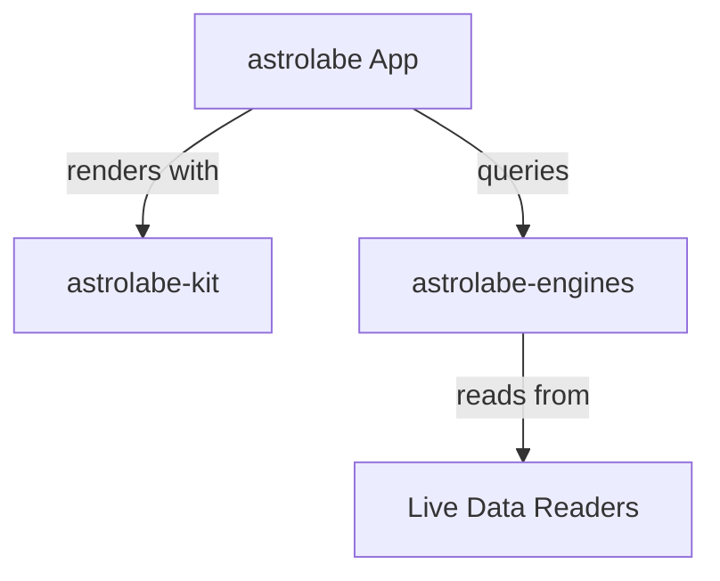

# Architecture

Astrolabe runs as one Rust application built on live data readers, shared engines, and reusable UI widgets.

Dependency flow across the current Astrolabe crates and readers.

## Current Crate Boundaries

One Rust binary (`astrolabe`) owns the window, workspace chrome, and app views. Shared UI primitives live in `astrolabe-kit`, and the logic from Repo Monitor and Agent Monitor moves into `astrolabe-engines`. Live data readers inspect local Git repositories, files, and provider CLI probes on demand. [Astrolabe Architecture](architecture.md) specifies the full design, contract model, and open decisions.

## Incremental Growth

Astrolabe avoids speculative infrastructure during consolidation. Persistence, record IDs, event logs, protocol crates, and a daemon stay out of the core path until a real feature needs them. That discipline keeps the single application direct while [Product Direction](../introduction/direction.md) guides later layers.
