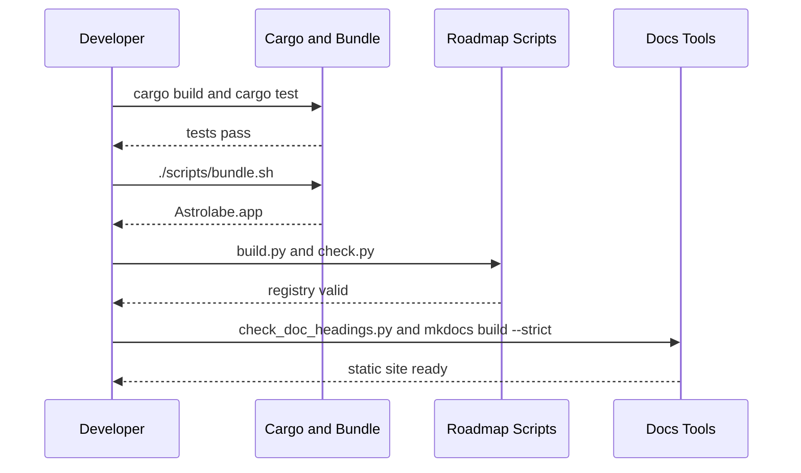

# Development Basics

Build the Rust workspace, run tests, package the macOS app bundle, verify the roadmap, and build the documentation site.



Local build and verification sequence across Cargo, bundle tools, roadmap scripts, and MkDocs.

## Requirements

The table lists the tools required on macOS for a full local build and verification pass.

| Requirement | Detail |
|---|---|
| Rust toolchain | Rust compiler and Cargo with Edition 2024 support |
| macOS tools | `plutil`, `sips`, `iconutil`, and `codesign` for app bundling |
| Python | Python 3 for roadmap scripts and heading checks |
| `uv` | `uvx` runner for pinned MkDocs builds |

## Steps

### Workspace Build and Launch

1. Compile all crates in the workspace from the repository root.

    ```bash
    cargo build --workspace
    ```

2. Launch Astrolabe with live repository and agent engines.

    ```bash
    cargo run -p astrolabe
    ```

3. Launch Astrolabe in isolated demo mode without live local state.

    ```bash
    cargo run -p astrolabe -- --demo
    ```

Pass `--panel repos` or `--panel agents` after `--demo` to open a specific panel immediately.

### Workspace Tests

1. Run unit tests across all four crates.

    ```bash
    cargo test
    ```

The suite verifies Git and query logic, provider parsers, Keychain caching, layout geometry, and offscreen snapshot tests.

### Application Bundle

1. Build and sign the native macOS bundle.

    ```bash
    ./scripts/bundle.sh
    ```

The script builds the release `astrolabe` binary and forwards extra CLI arguments directly to `cargo build`. It writes `${CARGO_TARGET_DIR:-target}/bundle/Astrolabe.app` (`target/bundle/Astrolabe.app` by default) with a validated `Info.plist` for macOS 13.0 or newer.

The script also generates `AppIcon.icns` from `docs-theme/assets/astrolabe-icon-minerals.svg` through `resvg`, `rsvg-convert`, or `sips` with `iconutil`. Then `codesign` applies and verifies an ad-hoc signature on the bundle.

### Roadmap Build and Check

1. Regenerate the roadmap Markdown page from `roadmap/*.yml`.

    ```bash
    python3 roadmap/build.py
    ```

2. Validate the roadmap registry, dependency graph, doc links, privacy checks, and generated page.

    ```bash
    python3 roadmap/check.py
    ```

### Documentation Checks and Build

1. Check every Markdown heading under `docs/` against the Title Case rule.

    ```bash
    python3 scripts/check_doc_headings.py
    ```

    ```text
    0 of N docs headings break the title rule
    ```

2. Build the documentation site in strict mode with pinned `uvx` packages.

    ```bash
    uvx --from mkdocs==1.6.1 \
      --with mkdocs-material==9.8.1 \
      --with mkdocs-awesome-nav==3.3.0 \
      --with pymdown-extensions==13.1 \
      mkdocs build --strict -d build/docs-site
    ```

`mkdocs.yml` sets `validation.anchors: warn`. Thus `--strict` fails on any broken internal link or absent heading anchor.

## Result

All workspace builds and tests pass, and `./scripts/bundle.sh` writes a verified `Astrolabe.app` bundle. Both roadmap scripts exit with code 0. Zero documentation headings fail `check_doc_headings.py`, and MkDocs writes the static site to `build/docs-site` with exit code 0.

## Errors

| Symptom | Cause | Remedy |
|---|---|---|
| Bundle script fails on icon | Icon SVG missing from `docs-theme/assets/` | Restore `docs-theme/assets/astrolabe-icon-minerals.svg` and rerun `./scripts/bundle.sh` |
| Roadmap check reports out of date | `roadmap/*.yml` changed without regeneration | Run `python3 roadmap/build.py` and repeat `python3 roadmap/check.py` |
| Heading check exits 1 | Heading breaks Title Case or article rules | Rewrite the heading as a Title Case noun phrase without articles |
| Strict build warns on anchor | Internal link targets a missing heading | Fix the target anchor or page path in Markdown |
| `uvx: command not found` | `uv` is not on `PATH` | Install `uv` and repeat the documentation build command |
