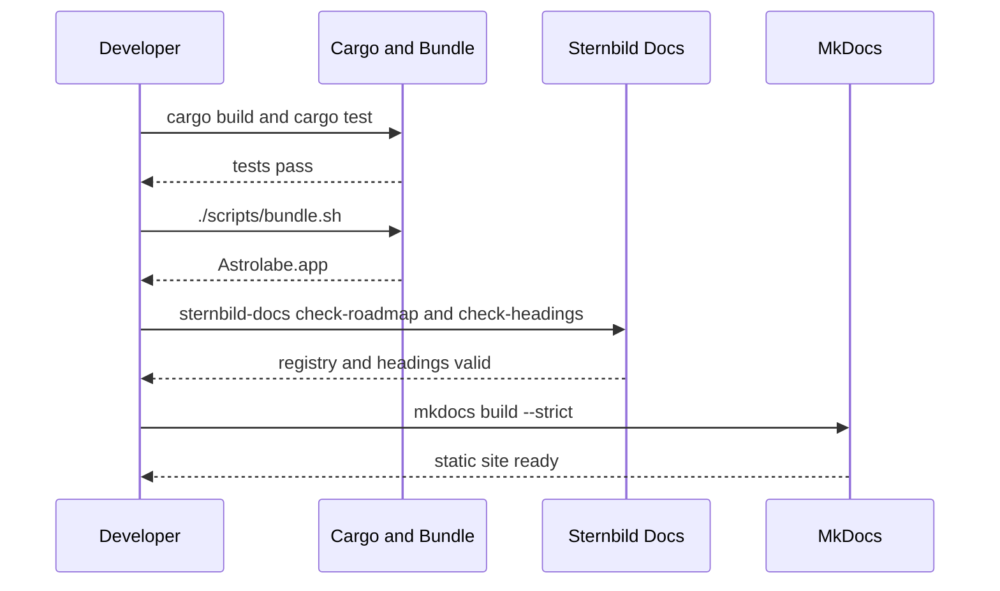

# Development Basics

Build the Rust workspace, run tests, package the macOS app bundle, verify the roadmap, and build the documentation site.



Local build and verification sequence across Cargo, bundle tools, `sternbild-docs`, and MkDocs.

## Requirements

The table lists the tools required on macOS for a full local build and verification pass.

| Requirement | Detail |
|---|---|
| Rust toolchain | Rust compiler and Cargo with Edition 2024 support |
| macOS tools | `plutil`, `sips`, `iconutil`, and `codesign` for app bundling |
| Python | Python 3 for `sternbild-docs` checks and MkDocs builds |
| `uv` | `uvx` runner for `sternbild-docs` and pinned MkDocs commands |

## Steps

### Workspace Build and Launch

1. Compile all crates in the workspace from the repository root.

    ```bash
    cargo build --workspace
    ```

2. Launch Astrolabe with live repository and agent engines.

    ```bash
    cargo run -p astrolabe
    ```

3. Launch Astrolabe in isolated demo mode without live local state.

    ```bash
    cargo run -p astrolabe -- --demo
    ```

Pass `--panel repos` or `--panel agents` after `--demo` to open a specific panel immediately.

### Workspace Tests

1. Run unit tests across all four crates.

    ```bash
    cargo test
    ```

The suite verifies Git and query logic, provider parsers, Keychain caching, layout geometry, and offscreen snapshot tests.

### Application Bundle

1. Build and sign the native macOS bundle.

    ```bash
    ./scripts/bundle.sh
    ```

The script builds the release `astrolabe` binary and forwards extra CLI arguments directly to `cargo build`. It writes `${CARGO_TARGET_DIR:-target}/bundle/Astrolabe.app` (`target/bundle/Astrolabe.app` by default) with a validated `Info.plist` for macOS 13.0 or newer.

The script calls `astrolabe --write-bundle-icon` to extract the canonical 1024 px Minerals PNG from `sternbild-tokens`, then builds `AppIcon.icns` with `sips` and `iconutil`. Then `codesign` applies and verifies an ad-hoc signature on the bundle.

### Roadmap Check

1. Validate the roadmap registry, dependency graph, doc links, and privacy rules.

    ```bash
    uvx --from "git+https://github.com/AhmedKhan-GH/organization@docs-v1.0.1#subdirectory=packages/sternbild-docs" \
      sternbild-docs check-roadmap --strict-titles --strict-core-scope
    ```

`mkdocs.yml` enables the `sternbild` plugin during the site build. The plugin generates the pillar pages, feature pages, `roadmap/graph.json`, and `roadmap.json` in memory. Run `sternbild-docs build-roadmap --out DIR` to write those files to a folder.

### Documentation Checks and Build

1. Check every Markdown heading under `docs/` against the Title Case rule.

    ```bash
    uvx --from "git+https://github.com/AhmedKhan-GH/organization@docs-v1.0.1#subdirectory=packages/sternbild-docs" \
      sternbild-docs check-headings
    ```

    ```text
    0 of N docs headings break the title rule
    ```

2. Serve the documentation site locally with live reload for edits.

    ```bash
    uvx --from mkdocs==1.6.1 \
      --with mkdocs-material==9.8.1 \
      --with mkdocs-awesome-nav==3.3.0 \
      --with pymdown-extensions==13.1 \
      --with "git+https://github.com/AhmedKhan-GH/organization@docs-v1.0.1#subdirectory=packages/sternbild-docs" \
      mkdocs serve
    ```

3. Build the documentation site in strict mode with pinned `uvx` packages.

    ```bash
    uvx --from mkdocs==1.6.1 \
      --with mkdocs-material==9.8.1 \
      --with mkdocs-awesome-nav==3.3.0 \
      --with pymdown-extensions==13.1 \
      --with "git+https://github.com/AhmedKhan-GH/organization@docs-v1.0.1#subdirectory=packages/sternbild-docs" \
      mkdocs build --strict -d build/docs-site
    ```

`mkdocs.yml` sets `validation.anchors: warn`. Thus `--strict` fails on any broken internal link or absent heading anchor.

## Result

All workspace builds and tests pass, and `./scripts/bundle.sh` writes a verified `Astrolabe.app` bundle. `sternbild-docs check-roadmap` exits with code 0. Zero documentation headings fail `sternbild-docs check-headings`, and MkDocs writes the static site to `build/docs-site` with exit code 0.

## Errors

| Symptom | Cause | Remedy |
|---|---|---|
| Bundle script fails on icon | Binary failed to emit the embedded PNG or `iconutil` failed | Verify `cargo build --release -p astrolabe` succeeds and rerun `./scripts/bundle.sh` |
| Roadmap check exits 1 | Invalid YAML, broken link, or absent pillar entry | Fix the reported `roadmap/*.yml` or `docs/roadmap/.nav.yml` entry and repeat `sternbild-docs check-roadmap` |
| Heading check exits 1 | Heading breaks Title Case or article rules | Rewrite the heading as a Title Case noun phrase without articles |
| Strict build warns on anchor | Internal link targets an absent heading | Fix the target anchor or page path in Markdown |
| `uvx: command not found` | `uv` is not on `PATH` | Install `uv` and repeat the documentation build command |
