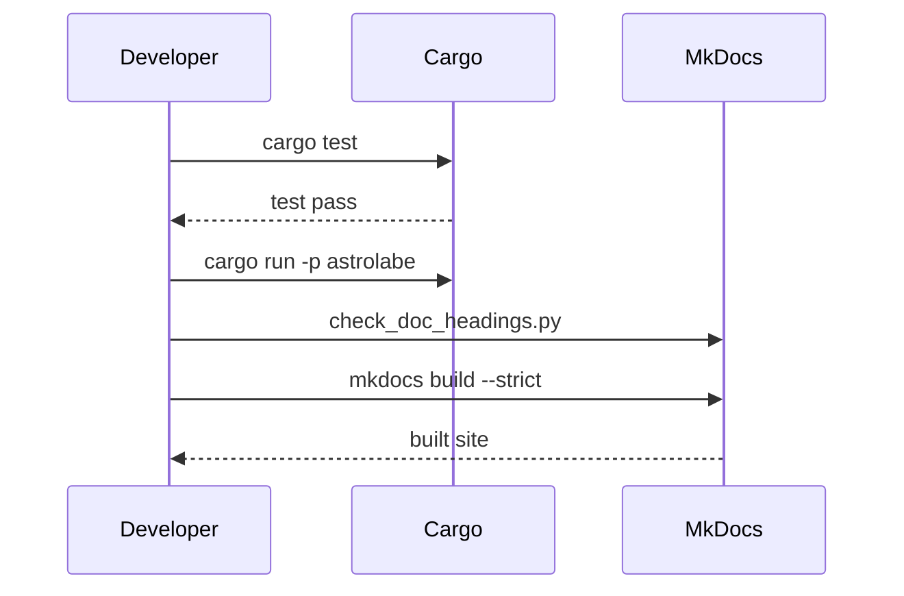

# Development Basics

Build the Rust workspace, run the tests, and verify the documentation site from a clean checkout.



Local verification sequence across Cargo and the documentation tools.

## Requirements

| Requirement | Detail |
|---|---|
| Rust toolchain | Rust compiler and Cargo with Edition 2024 support |
| Python | Python 3 for heading verification |
| `uv` | `uvx` runner for pinned MkDocs builds |

## Steps

### Workspace Test

1. Run the workspace unit tests from the repository root.

    ```bash
    cargo test
    ```

### Application Launch

1. Build and run the `astrolabe` package.

    ```bash
    cargo run -p astrolabe
    ```

### Heading Check

1. Check every Markdown heading under `docs/` against the title rule.

    ```bash
    python3 scripts/check_doc_headings.py
    ```

    ```text
    0 of N docs headings break the title rule
    ```

### Documentation Build

1. Build the documentation site in strict mode with pinned dependencies.

    ```bash
    uvx --from mkdocs==1.6.1 \
      --with mkdocs-material==9.8.1 \
      --with mkdocs-awesome-nav==3.3.0 \
      --with pymdown-extensions==13.1 \
      mkdocs build --strict -d build/docs-site
    ```

## Result

All Cargo workspace tests pass, and `astrolabe` starts without errors. Zero documentation headings fail the title check, and MkDocs writes the static site to `build/docs-site` with exit code 0.

## Errors

| Symptom | Cause | Remedy |
|---|---|---|
| Heading check exits 1 | Heading breaks Title Case or article rules | Rewrite the heading as a Title Case noun phrase without articles |
| Strict build warns on anchor | Internal link targets a missing heading | Fix the target anchor or page path in Markdown |
| `uvx: command not found` | `uv` is not installed on `PATH` | Install `uv` and repeat the documentation build command |
