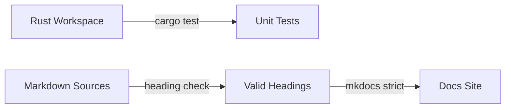

# Development

Development covers source builds, tests, and documentation checks for contributors who work on the Astrolabe repository.

Build and verification paths for the Rust crates and the documentation site.

## Workspace Workflow

The repository uses one Cargo workspace for `astrolabe` and its library crates. Contributors build and test the workspace locally with Cargo before they commit changes. [Development Basics](development-basics.md) gives the required tools and commands.

## Documentation Checks

Documentation lives under `docs/` and builds with MkDocs Material and `awesome-nav` in strict mode. Every heading must pass `scripts/check_doc_headings.py`, and every interface change must satisfy [UI Principles](../interface/ui-principles.md).
