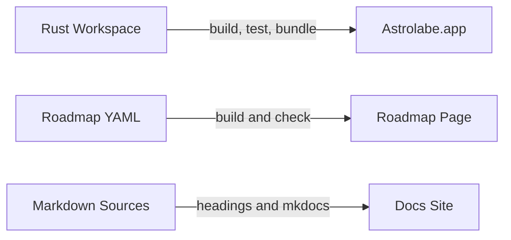

# Development

Development covers workspace builds, tests, macOS app bundles, roadmap verification, and documentation builds for contributors.

Local build and verification paths across Rust crates, roadmap sources, and documentation.

## Workspace Workflow

One Cargo workspace compiles `astrolabe`, `astrolabe-kit`, `astrolabe-engines`, and `astrolabe-contract`. Contributors build, launch in live or `--demo` mode, run `cargo test`, and package `Astrolabe.app` through `./scripts/bundle.sh`. [Development Basics](development-basics.md) lists all requirements and commands.

## Roadmap and Documentation

Roadmap sources live under `roadmap/*.yml` and compile through `roadmap/build.py` and `roadmap/check.py`. Documentation lives under `docs/` and compiles with pinned MkDocs Material packages in strict mode. Every heading must pass `scripts/check_doc_headings.py`, and every interface change must follow [UI Principles](../interface/ui-principles.md).
