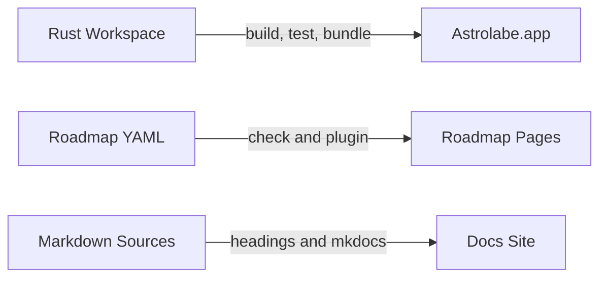

# Development

Development covers workspace builds, tests, macOS app bundles, roadmap verification, and documentation builds for contributors.

Local build and verification paths across Rust crates, roadmap sources, and documentation.

## Workspace Workflow

One Cargo workspace compiles `astrolabe`, `astrolabe-kit`, `astrolabe-engines`, and `astrolabe-contract`. Contributors build, launch in live or `--demo` mode, run `cargo test`, and package `Astrolabe.app` through `./scripts/bundle.sh`. [Development Basics](development-basics.md) lists all requirements and commands.

## Roadmap and Documentation

`sternbild-docs check-roadmap` validates the roadmap YAML files under `roadmap/`, and the `sternbild` plugin generates roadmap pages during the MkDocs build. Documentation lives under `docs/` and compiles in strict mode with `sternbild-docs` and pinned MkDocs packages. Every heading must pass `sternbild-docs check-headings`, and every interface change must follow [UI Principles](../interface/ui-principles.md).
