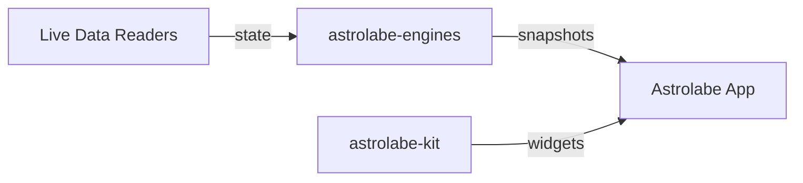

# Introduction

Astrolabe is a single desktop application for specialized work and agent supervision.

Core components inside the Astrolabe Rust workspace.

## Product Scope

Astrolabe combines specialized interfaces with agent orchestration in one application. The monitors move their engines into Astrolabe, and standalone Repo Monitor and Agent Monitor retire when Astrolabe matches them. [Product Direction](introduction/direction.md) states the requirements, layer model, and consolidation plan.

## Application Structure

The current system is one Rust app (`astrolabe`), live data readers, engines in `astrolabe-engines`, and UI widgets in `astrolabe-kit`. Persistence, record IDs, event logs, protocol crates, and a daemon enter the codebase only when a feature needs them. The [Architecture](architecture/index.md), [Interface](interface/index.md), and [Apps](apps/index.md) areas describe each part in detail.
