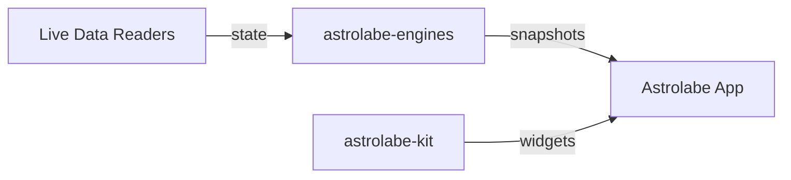

# Introduction

Astrolabe is an ecosystem that manages knowledge and assets across specialized applications. It lets people observe everything and never lose track of it. It adds agentic integration where that integration is instrumental to accelerate workflows and create new ones. The design emphasizes principled and organized thought across every view and workflow.

Core components inside the Astrolabe Rust workspace.

## Shipped Capabilities

[Repos](apps/repos.md) provides live repository observation across watched folders on macOS. It reads branch, worktree, stash, submodule, and remote divergence status directly from local Git checkouts. Sidebar filters group repositories by Repository Location (`Local Only`, `Remote Only`, and `Both`) alongside automatic status, app, language, and category tags. The panel also includes Watched Folders management, manual tags, nested folders, and boolean smart folders.

[Agents](apps/agents.md) tracks subscription quotas and credit balances across command-line tools and hosted providers. It also inspects local Ollama models for GPU memory, KV cache estimates, context length, and recent memory trends. Background probes discover installed agent tools and report setup or availability states for 13 providers. API key settings store optional provider credentials in the macOS login Keychain.

Astrolabe ships as one native Rust application for macOS. The binary combines shared widgets from `astrolabe-kit` with live domain engines in `astrolabe-engines`. Direct readers inspect local repositories, files, Ollama, and provider probes without a background service. A deterministic `--demo` mode loads synthetic fixtures in memory for safe inspection and automated tests.

## Product Direction

[Product Direction](introduction/direction.md) defines the plan for cross-application indexes, workspace observation views, supervised agent workflows, and a background service. Astrolabe connects assets across specialized desktop tools and does not replace those tools. Each new capability enters the workspace only when a concrete product need requires it.

## Documentation Map

The table maps each area of the Astrolabe documentation.

| Section | Scope |
|---|---|
| [Product Direction](introduction/direction.md) | Core definition, current capabilities, and planned workspace evolution. |
| [Architecture](architecture/index.md) | Crate layout, live data readers, and incremental infrastructure design. |
| [Interface](interface/index.md) | Visual tokens, layout rules, and shared `astrolabe-kit` widgets. |
| [Apps](apps/index.md) | Reference guides for the [Repos](apps/repos.md) and [Agents](apps/agents.md) panels. |
| [Roadmap](roadmap/index.md) | Planned milestones and sequenced delivery scope. |
| [Development](development/index.md) | Rust build commands, unit tests, and documentation checks. |
