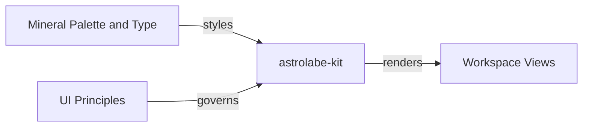
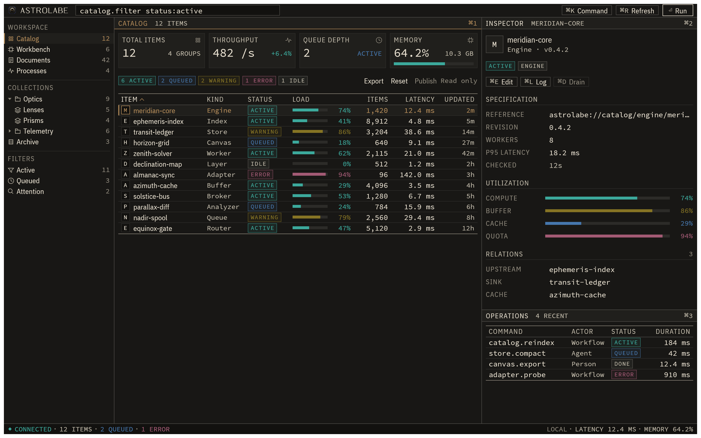

# Interface

Astrolabe uses a dense dark workstation interface built on shared widgets in `astrolabe-kit` and strict structural rules.

Design tokens and layout rules flow through `astrolabe-kit` into every Astrolabe view.

## Visual System

The interface uses a warm mineral dark palette with square corners, 1 px structural rules, and zero drop shadows. Bronze (`#b38b59`) marks only keyboard focus and active selection, distinct from every data status color.

Typography follows three strict roles across the application and documentation. `SternbildDisplay` is reserved only for the name `Astrolabe`. Headings, controls, and body copy use `IBM Plex Sans Condensed`, and paths, metrics, and code use `Source Code Pro`.

## Interface Kit

Shared shell chrome, data tables, summary tiles, status chips, usage bars, layout math, and offscreen snapshot helpers live in `astrolabe-kit`. Every built-in view reuses these components to keep keyboard behavior, density, and visual alignment uniform. [UI Principles](ui-principles.md) defines the tokens, component catalog, text rules, layout rules, and verification checks.

The `astrolabe-kit` showcase window displays the command bar, sidebar rail, summary tiles, data table, inspector pane, and status bar.
