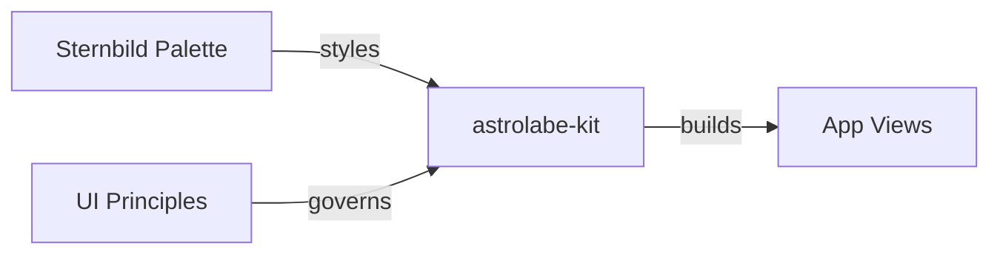

# Interface

Astrolabe uses a dense dark workstation interface built on shared widgets in `astrolabe-kit` and strict structural rules.

Palette tokens and structural rules flow through `astrolabe-kit` into each view.

## Visual Direction

The interface uses the Sternbild dark palette with bronze as the single accent, square corners, and hairline rules. `Sternbild Display` applies only to the word `Astrolabe`. Headings and body text use the text face, and code or telemetry values use a monospace face.

## Shared Widgets

Shared layout primitives, tables, indicators, and controls live in `astrolabe-kit`. Thus Repos, Agents, and future apps keep consistent behavior. [UI Principles](ui-principles.md) defines the text, layout, behavior, color, and check rules for every screen.

The `astrolabe-kit` showcase window shows the command bar, sidebar rail, metric tiles, data table, inspector pane, and status bar.
