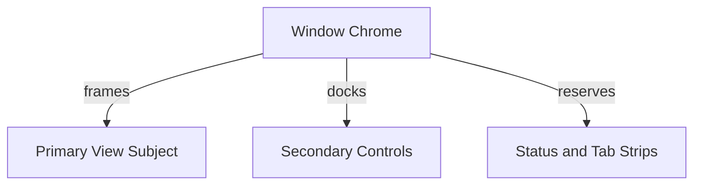

# UI Principles

Structural and visual rules for the Astrolabe host, `astrolabe-kit`, and every built-in app view.

Layout hierarchy inside one Astrolabe window.

## Tokens

The interface uses the Sternbild dark palette with bronze as the single accent, square corners, and 1 px hairline rules. The table lists the primary typography and surface rules enforced across `astrolabe-kit`.

| Element | Rule |
|---|---|
| Wordmark `Astrolabe` | `Sternbild Display` applies only to the word `Astrolabe` |
| Headings and body text | `IBM Plex Sans Condensed` with uppercase headings and regular body text |
| Code and telemetry | `Source Code Pro` for identifiers, commands, paths, and numeric readouts |
| Accent color | Bronze `#b38b59` as the single accent across active states and markers |
| Geometry | Square or small-radius plates with 1 px rules and no heavy drop shadows |

## Text

Labels, arrangement, and icons carry the meaning of a screen without explanatory prose. The interface contains no taglines, pane subtitles, sentences beside controls, help lines, or view footers.

Labels are nouns or short noun phrases such as `Repositories`, `Branches`, `Quota`, or `Active Sessions`. Legends pair a symbol with a noun. Every item keeps one consistent name across headers, lists, charts, legends, and tables instead of pointer words such as `this item`, `current`, `here`, or `selected`.

Tooltips display only names and values. Every line, ring, bar, or badge in a data view has a visible label or legend entry. As a result, a reader can interpret each mark without source knowledge.

## Explanation

Explanation lives in one on-demand place such as a guided tour or an info button beside a title, never on the main surface. A tour is stored as structured data beside the view so developers can update text without code changes. Each tour step names its target region and uses a title with at most two plain sentences.

## Layout

The subject under study takes the largest region of the window, while controls and secondary panels sit beside it. Panes claim proportional shares of the window rather than fixed pixel widths. Each pane has a minimum size that scales with the text scale setting and no upper limit. Thus a larger window gives every pane more room.

Different questions belong in separate tabs rather than extra panes packed into one screen. Host chrome such as the tab bar and status strip occupies dedicated edge strips, and panes fill only the open space. No host banner covers a pane unless the user opens a transient overlay.

## Behavior

Every screen opens quietly with no motion or playback until the user chooses an action. Every setting has exactly one control in the interface. Other views display the value but never mutate it. Selection stays linked across views. When a user selects a repository or agent session in one pane, every related pane highlights the same entity.

## Color and Size

One color key governs the entire application. Thus the same status, class, or provider keeps the same color in every pane. Annotation marks use a distinct color separate from data categories. Text scale is a single setting that adjusts fonts, spacing metrics, and pane minimums together.

## Layout Checks

Layout code computes pane rectangles as plain geometry separate from rendering code so automated unit tests can check sizes without a live window. Contributors verify layout changes at two window sizes, such as `2560 x 1440` and `1440 x 900` logical pixels, before they accept the change. Runtime UI layout warnings count as failures in development builds.
