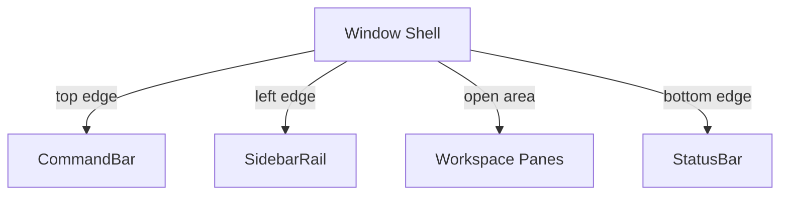

# UI Principles

Structural, visual, and behavioral rules for Astrolabe and its shared `astrolabe-kit` component library.

Layout hierarchy inside one Astrolabe desktop window.

## Tokens

Astrolabe uses a warm mineral dark palette with square corners, 1 px structural rules, and zero drop shadows. `SternbildDisplay` is reserved only for the name `Astrolabe`. Headings, controls, and body copy use `IBM Plex Sans Condensed`, and paths, metrics, and code use `Source Code Pro`.

| Token Group | Role | Specification |
|---|---|---|
| Wordmark `Astrolabe` | Brand name only | `SternbildDisplay`, never used for headings or controls |
| UI Typography | Headings, controls, body copy | `IBM Plex Sans Condensed` |
| Monospace Typography | Paths, metrics, identifiers, code | `Source Code Pro` with tabular figures |
| Mineral Surfaces | Recessed, ground, plate, hover | `#12110f`, `#181715`, `#201f1c`, `#2a2925` |
| Structural Rules | Dividers and control borders | 1 px `#4b4945` (`RULE`) and `#2c2b28` (`RULE_FAINT`) |
| Neutral Ink | Primary, secondary, faint text | `#e8e0d0`, `#c1baaa`, `#8f897c` |
| Focus Accent | Keyboard focus and active selection | Bronze `#b38b59`, never used for data status |
| Status Pigments | `OK`, `INFO`, `WARN`, `ERROR`, `Neutral` | `#4ca986`, `#6195cc`, `#d9b84e`, `#d8645e`, `#c1baaa` |

## Components

The `astrolabe-kit` crate packages every visual primitive behind clean Rust modules. Views compose shell chrome, data tables, summary tiles, and inspectors without duplicate styles or layout math.

| Module | Components | Purpose |
|---|---|---|
| `tokens` and `theme` | `color`, `metric`, `font_size`, `StatusTone`, `install`, `install_with` | Install fonts, mineral dark visuals, and global text scale (`0.75` to `2.0`) |
| `layout` | `ShellSpec`, `ShellRects`, `split_horizontal`, `split_vertical`, `grid_rects`, `pane_child` | Compute non-overlapping pane rectangles as pure geometry |
| `chrome` | `CommandBar`, `SidebarRail`, `Pane`, `StatusBar`, `masthead`, `key_button`, `primary_button` | Draw workstation chrome, navigation rail, framed panes, and action controls |
| `data` | `DataTable`, `MetricTileSpec`, `metric_tile_row`, `status_chip`, `labeled_usage_bar`, `field_row` | Render dense tables, summary tiles, status chips, usage meters, and inspector fields |
| `draw` | `IconKind`, `rule_h`, `rule_v`, `box_outline`, `astrolabe_mark`, `icon_glyph` | Paint crisp 1 px rules, square outlines, and vector icons |
| `capture` | `CaptureConfig`, `render_ui_png`, `render_eframe_png` | Render views offscreen with headless `wgpu` for automated visual verification |

## Text

Labels, spatial arrangement, and icons carry screen meaning without explanatory prose. The interface contains no taglines, pane subtitles, helper sentences beside controls, or decorative footers.

Labels use nouns or short noun phrases such as `Repositories`, `Branches`, `Account Limits`, or `Ollama Models`. Legends pair each symbol with one clear noun. Every item keeps one consistent name across headers, lists, charts, legends, and tables instead of pointer words such as `this item`, `current`, `here`, or `selected`.

Tooltips display only names and values. Every line, bar, chip, or badge in a data view carries a visible label or legend entry. As a result, a reader interprets every mark directly from the screen.

## Explanation

Explanation lives in one on-demand location such as a guided tour or an info control beside a title, never on the main work surface. Structured tour data lives beside the view code for direct maintenance. Each tour step names its target region and uses a title with at most two plain sentences.

## Layout

The primary subject occupies the largest area of the window, while controls and secondary inspectors sit beside it. Panes claim proportional shares of the available space rather than fixed pixel widths. Each pane declares a minimum size that scales with the text scale setting and carries no upper limit. Thus a larger monitor gives every pane more room.

Different questions belong in separate panels or views rather than extra panes crowded into one screen. Dedicated edge strips hold the top `CommandBar` (`34 px`) and bottom `StatusBar` (`24 px`), and panes fill the open workspace. No status banner obscures a pane unless the user opens a transient modal overlay.

## Behavior

Every screen opens quietly with zero implicit animation, zero scroll animation, and zero cursor blink (`animation_time = 0.0`). Motion occurs only in response to direct user input.

Every setting has one clear control in the interface, while other views display the value without hidden mutation. Selection stays linked across panes. When a user selects a repository or provider in one pane, every related pane highlights the same entity.

## Color and Size

One color key governs the entire application. Thus each status tone keeps the same visual meaning across Repos, Agents, and future panels. Bronze marks only focus and active selection, and automated unit tests confirm that no `StatusTone` reuses bronze.

One global `text_scale` multiplier adjusts font sizes, spacing metrics, and pane minimums together. Plot series use a fixed five-pigment mineral palette separate from chrome and focus accents.

## Layout Checks

Layout functions in `astrolabe-kit::layout` compute pane rectangles as plain `egui::Rect` geometry separate from rendering code. Unit tests verify shell strips, sidebar bounds, and tiled splits without a live OS window.

Contributors verify layout invariants and offscreen captures at `1440 x 900` and `2560 x 1440` logical pixels before they merge UI changes. Runtime layout warnings count as failures during development checks.
