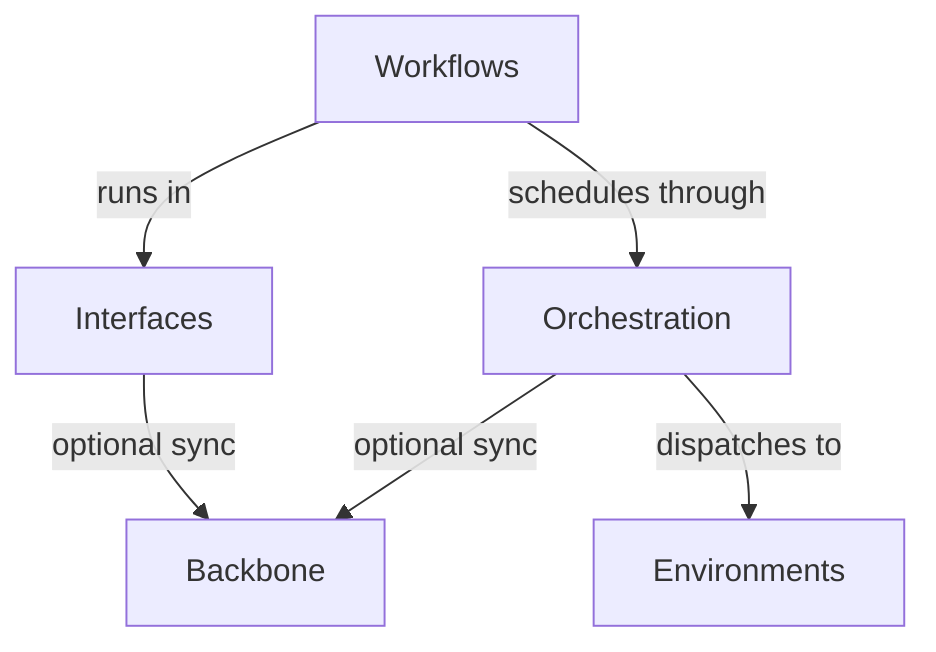

# Product Direction

Product direction defines the purpose, requirements, workflow definition, layer model, and single-application consolidation plan for Astrolabe.

Five layers that organize Astrolabe from local interfaces to hosted workflows.

## Components

Astrolabe is a single desktop productivity application for specialized work and agent supervision. It brings containerized Artisan workflows, Repo Monitor, and Agent Monitor into one Rust application. People use it to build clean workflows that carry literature and taste, observe each run, and intervene when necessary.

Astrolabe takes a workflow that works for one person and runs it at production scale with expertise built in. The same workflow definition applies on one machine, on hosted capacity, in parallel, and for a team. A change of scale does not demand a new workflow.

Astrolabe combines agent orchestration with specialized interfaces. Each app keeps an interface that fits its work, and shared context connects the views. A document, selection, source, or link can pass between views while the person chooses where agents act and observes the result in the same application.

## Pain Points as Requirements

Product reviews identify nine operational problems across earlier projects. Four requirements matter most: an agreed spec, durable feedback, visibility with evidence, and a durable ledger. Agent routing, managed environments, and hosted capacity extend that foundation.

**Wrong brief.** Agents produced mismatched demos and drafts when tasks started without alignment. Each task must start with a short plan that the person approves, and that agreed spec must govern both the work and the checks.

**Repeated corrections.** Style instructions and project rules needed repeated explanation across sections, agents, and memory files. Each correction must become a durable rule or check that every agent and model inherits on later runs.

**Hidden progress.** People had to request status and inspect background runs by hand. Astrolabe must show the progress, changes, and blockers of each run as they occur and notify the person when a run needs attention.

**Claims without proof.** Reports of complete work needed extra checks when tests were unreliable. Every claim must carry its evidence, and tests, captures, and diffs must stay with the result they support.

**Separate agents, accounts, and limits.** Claude, Codex, Kimi, GLM, Antigravity, and Ollama each brought separate quotas, sign-ins, permission prompts, and CLI behavior. Astrolabe must give one layer across agents that routes tasks by model and available capacity. The [Agents](../apps/agents.md) app supplies the basis through its view of limits across providers.

**Overloaded machines and abandoned resources.** Build jobs saturated local hardware, and agent runs left open applications behind. Environments must apply resource budgets and clean up when a run ends, and work must move to extra capacity when the local machine is full.

**Repeated boundaries.** Rules about repository copies, pushes, protected machines, and email needed repeated statements. These rules must belong to the workspace, and Astrolabe must apply them through the standard permission settings of each tool.

**Lost work and context.** Context compaction, reboot losses, uncommitted edits, and queues held only in conversation caused gaps between sessions. A durable ledger must keep open work, decisions, and handoffs across sessions and machines when workflow orchestration needs it.

**Mixed project threads.** Work on Caliper, Atlas, the monitors, Artisan, and experiments shared one conversation. Each project must keep a separate thread with its own state, visible from one place.

## Workflow Definition

A workflow is a spec, plus its rules and checks, plus its evidence, plus its history. The spec records the intended result before work starts. Rules and checks hold the constraints and the verification method, evidence supports the claims from each run, and history keeps the work and its corrections.

One definition applies at every scale. The workflow that runs locally must also run on hosted capacity, in parallel, and for a team without a rewrite. Environments and workflows need explicit declarations to support this transfer, and the declared format remains an open design decision.

Literature and taste enter the workflow through rules, checks, and curated sources. Literature supplies sources that support the work and its evidence. Taste supplies standards for the result, and corrections turn those standards into repeatable checks.

Curated expertise must arrive as a tested, versioned workflow with evaluations. A team can then assess a workflow through its measured results before adoption. Observation must scale with execution. Thus local and hosted agents appear in the same interfaces with the same budgets and history.

## Layer Model

Astrolabe spans five layers that give each current project a clear role.

**Environments** supply the places where agents run. Artisan supplies the first environment type as a desktop VM where agents operate real applications, and Alchemist is another instance of that type. Containers and hosted capacity also belong in this layer while the Craft apps stay applications that agents use inside those environments.

**Orchestration** decides which agent runs each task, where it runs, when it runs, and what budget it gets. Loggia supplies the internal installation of Astrolabe, and its code forms the orchestration layer. Quota data from the Agents app informs routing decisions.

**Interfaces** let the person observe and steer work through views that fit each domain. Built-in Astrolabe apps such as [Repos](../apps/repos.md) and [Agents](../apps/agents.md), along with Artisan Apps and the Craft apps, occupy this layer. Caliper stays a separate C++ product for machine learning, and Astrolabe embeds its views through Caliper Embed.

**Workflows** package expertise with checks and evidence. Writing loops, design loops, and research workflows live in this layer. Environments run the agents, orchestration schedules them, and interfaces show the results for review before the next run.

**Backbone** services supply shared accounts, sync, licensing, and billing across products. The backend name remains open because Alidade also names the learning platform. Local work must never depend on server availability.

## Consolidation Plan

Astrolabe is the single application now. The monitors move their engines into Astrolabe instead of separate standalone apps. Standalone Repo Monitor and Agent Monitor retire when Astrolabe matches them.

The current architecture is one Rust app (`astrolabe`), live data readers, engines in `astrolabe-engines`, and UI widgets in `astrolabe-kit`. When monitor logic moves into `astrolabe-engines` and shared widgets move into `astrolabe-kit`, Astrolabe delivers Repos and Agents in one window.

Persistence, record IDs, event logs, protocol crates, and a daemon enter the architecture only when a feature needs them. [Astrolabe Architecture](../architecture/architecture.md) records the crate layout, deferred infrastructure rules, and open design decisions.

## First Release

The first release ships the single Astrolabe application on the interfaces layer with the Repos and Agents apps. Live views of local repositories and cross-provider subscription limits give immediate daily value in one window. Other layers stay internal or deferred until the consolidated application needs them.

## Existing Solutions and Gap

The table records an assessment of current tools across the nine requirements.

| Need | Existing Solutions | Gap |
|---|---|---|
| Spec before work | Kiro, GitHub Spec Kit, Tessl, plan modes in Claude Code, Cursor, and Codex | Specs stay inside one tool or session and do not govern checks. |
| Durable feedback and rules | `AGENTS.md`, `CLAUDE.md`, Cursor rules, Claude Code skills, promptfoo, Braintrust, Langfuse | Agents can ignore text rules, and evaluation tools target AI app developers. |
| Visibility of agents | Conductor, Vibe Kanban, Claude Squad, Crystal, Sculptor, cloud agents, Devin, tracing tools | Most views cover code or one vendor, and tracing serves pipeline debugging. |
| Evidence for claims | Pull-request CI, Copilot agent, Devin, session recordings | Evidence covers code without an equivalent for designs, documents, or research. |
| Agents, accounts, and limits | OpenRouter, LiteLLM, Portkey, OpenCode, Goose, Aider, ccusage, menu-bar limit monitors | Gateways route API calls rather than subscription CLIs with separate quotas. |
| Environments and capacity | E2B, Daytona, Modal, Runloop, Morph, Tart, Orka, Cua | Infrastructure lacks links to workflows, rules, and unified observation. |
| Workspace boundaries | Claude Code and Codex permission settings, sandbox modes, guardrail tools | Each tool needs separate configuration of the same workspace rules. |
| Durable ledger | Linear, GitHub Issues, Beads, Taskmaster, Temporal, Inngest, Restate | Trackers lack live agent context, and durable engines are developer frameworks. |
| Packaged workflows and expertise | Apify Store, Claude plugin marketplaces, n8n, Zapier templates, GPT Store | Templates lack measured results that prove a workflow before adoption. |

The gap sits around the complete workflow: spec, rules, evidence, and history across vendors and across local and hosted environments. Nearest products cover single parts such as multi-agent code panels, single-vendor pull requests, or raw desktop VM infrastructure.

Astrolabe can adopt current infrastructure where it fits these requirements. Sandbox providers can supply capacity, and standard permission settings can enforce workspace rules. The value of Astrolabe comes from the direct connection across specialized interfaces, live observation, and repeatable workflows.
