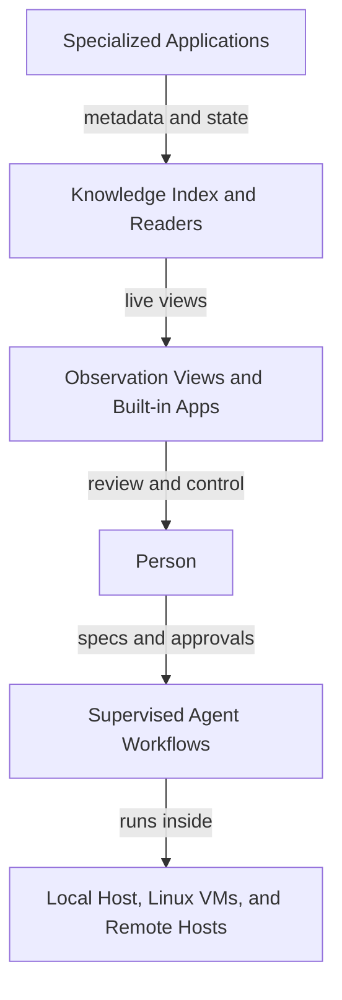

# Product Direction

Astrolabe is an ecosystem that manages knowledge and assets across specialized applications. It lets people observe everything and never lose track of it. It adds agentic integration where that integration is instrumental to accelerate workflows and create new ones. The design emphasizes principled and organized thought across every view and workflow.

System flow across specialized applications, observation views, human review, and supervised workflows.

## Core Principles

Astrolabe preserves specialized applications instead of a single general editor. Notes, reference libraries, media libraries, and source repositories already have capable native tools. Astrolabe observes state across those tools and connects related items in one workspace. As a result, people keep expert tools while they gain one shared view of active work.

Complete observation removes blind spots across projects and machines. When files, repositories, quotas, and automated tasks stay visible in one window, nothing slips out of sight. Each view surfaces current status and loose ends directly from live sources. People spot stale branches, uncommitted changes, quota pressure, or open decisions immediately.

Agentic integration enters a workflow only when automation accelerates work or enables a new capability. Every agent task begins with a clear specification, obeys durable workspace rules, and produces visible evidence beside each result. People inspect progress, verify outputs, and approve external or destructive actions before execution. Thus automation stays accountable to human judgment.

Principled and organized thought guides both the interface and the workflow model. Consistent labels, quiet screens, explicit structures, and repeatable checks reduce noise during deep work. Every control owns one clear purpose, and every claim links back to concrete artifacts.

## Current Capabilities

Astrolabe ships today as one native Rust application for macOS with two built-in apps and a deterministic demo mode.

### Repos

[Repos](../apps/repos.md) provides live repository observation across watched folders on macOS. Direct Git readers inspect branches, linked worktrees, stashes, submodules, sibling copies, and remote divergence status without a background daemon. Status flags highlight unreadable repositories, absent remotes, uncommitted changes, unpushed commits, behind branches, and remote updates in priority order.

The sidebar organizes repositories through Repository Location filters (`Local Only`, `Remote Only`, and `Both`) alongside automatic status, app, language, and category tags. The Watched Folders view adds, edits, and removes root paths in `config.toml` and triggers immediate rescans. People can also organize checkouts with manual tags, nested folders, and boolean smart folders that share one query grammar.

### Agents

[Agents](../apps/agents.md) tracks subscription quota windows and credit balances across command-line tools and hosted providers. Background probes discover installed agent tools and report usage windows, reset countdowns, credit balances, or setup states across 13 providers. Pseudo-terminal probes run inside an isolated folder and spend zero model tokens.

The lower pane inspects local Ollama models through the local API every five seconds. It reports disk size, resident memory, GPU footprint, active context length, KV cache estimates, loaded duration, and a 10-minute memory sparkline. API key settings store optional credentials for five hosted providers in the macOS login Keychain.

### Workspace and Demo Mode

The Rust binary (`astrolabe`) hosts the window chrome, navigation, and built-in views. Shared interface widgets and theme tokens live in `astrolabe-kit`, while live domain engines live in `astrolabe-engines`. [Astrolabe Architecture](../architecture/architecture.md) and [UI Principles](../interface/ui-principles.md) document the crate layout and visual rules.

A deterministic `--demo` mode runs the full interface with synthetic in-memory fixtures. Run `astrolabe --demo --panel repos` or `astrolabe --demo --panel agents` to inspect every panel state safely. Demo mode makes zero reads or writes to real repositories, configuration files, external apps, Keychain entries, or network hosts.

## Planned Direction

Astrolabe grows incrementally from the current desktop application toward cross-application knowledge management, unified workspace observation, supervised agent workflows, and a background service.

### Knowledge and Asset Index

Astrolabe will build a unified index for knowledge and assets across specialized desktop applications. The index will span notes, reference libraries, media libraries, and source repositories under one shared model. It will capture metadata, links, tags, and activity timestamps without a forced migration into a new file format.

Specialized tools remain the primary editors and viewers for their domains. Astrolabe links an item in a reference library to its notes, media assets, and code repositories. Thus related material stays connected across tools, and people can trace a project from one search or view.

### Workspace Observation Views

Cross-domain observation views will unify status across projects, repositories, agents, and local hardware. Four primary views organize daily attention:

- `Overview`: Summarizes active projects, recent movement across linked assets, and current workspace health.
- `Loose Ends`: Collects uncommitted edits, unpushed branches, stale drafts, and unfinished items before they disappear from view.
- `Needs You`: Lists open approval gates, blocked agent runs, and review items that wait for a decision.
- `Machine`: Reports local CPU pressure, memory load, resident models, and active workspace processes.

GitHub observation will extend repository status with pull requests, issues, review requests, and remote activity alongside local Git state. Local checkouts and remote collaboration stay aligned inside the same workspace.

### Supervised Agent Workflows

An integrated agent launcher will start and supervise agent workflows across local environments, managed Linux VMs, and remote hosts. Managed Linux VMs isolate automated work with clear resource budgets and clean teardown after each run. Remote hosts extend capacity when heavy builds or parallel runs exceed local hardware limits.

Every supervised workflow pairs an explicit specification with durable workspace rules, automated checks, and visible evidence. People watch live progress, inspect diffs or rendered results, pause execution, or take over directly inside the workspace. Every external or destructive action pauses for explicit human review and approval before execution.

### Background Service

An optional background service will enter the architecture when continuous features require work outside an open window. The service will support continuous index updates across specialized applications, persistent workspace observation, and unattended workflow execution. Direct local readers remain the foundation until a feature needs persistent background state.

## Capability Horizon

The table contrasts current shipped capabilities with planned product capabilities across core areas.

| Area | Current | Planned |
|---|---|---|
| Knowledge and Assets | Live observation of Git repositories across watched folders. | Unified index across notes, reference libraries, media libraries, and repositories. |
| Observation Views | Built-in [Repos](../apps/repos.md) and [Agents](../apps/agents.md) panels. | `Overview`, `Loose Ends`, `Needs You`, `Machine`, and GitHub observation. |
| Agent Execution | Quota windows, credit balances, Ollama memory, and tool discovery. | Agent launcher and supervised workflows in managed Linux VMs and remote hosts. |
| Runtime Model | Single Rust app for macOS with live readers and `--demo` mode. | Optional background service for continuous index updates, observation, and workflows. |
