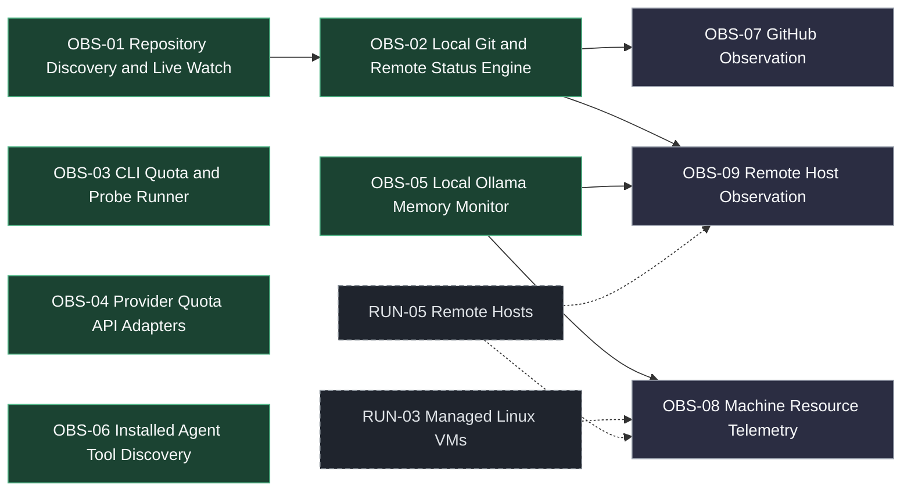
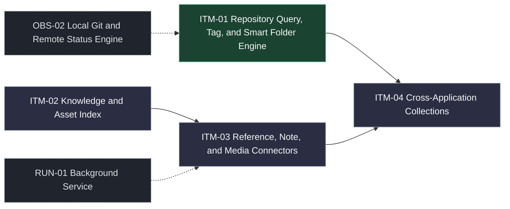
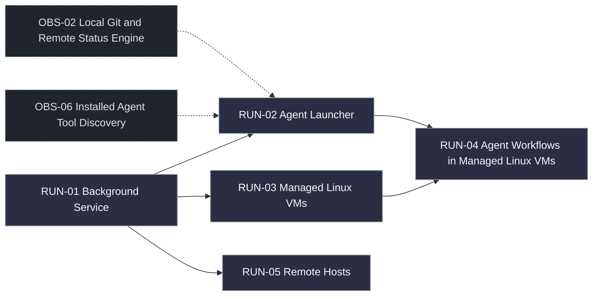
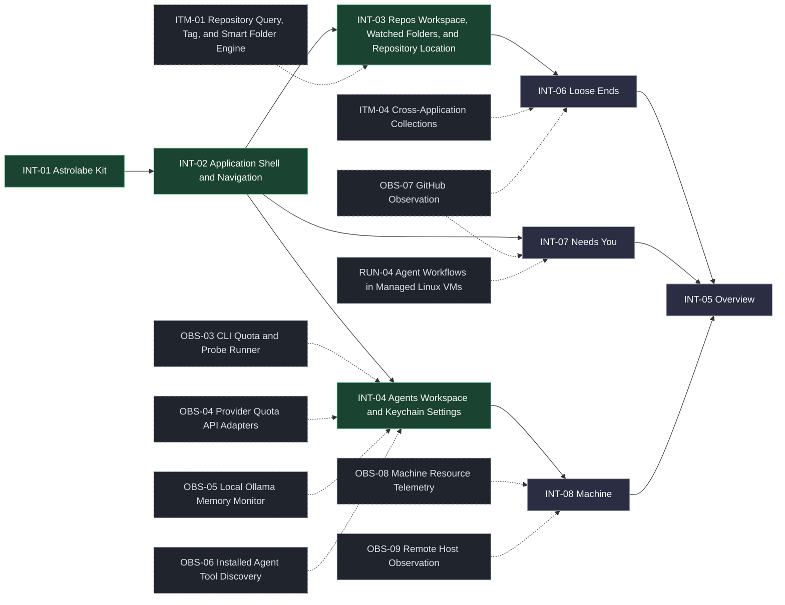
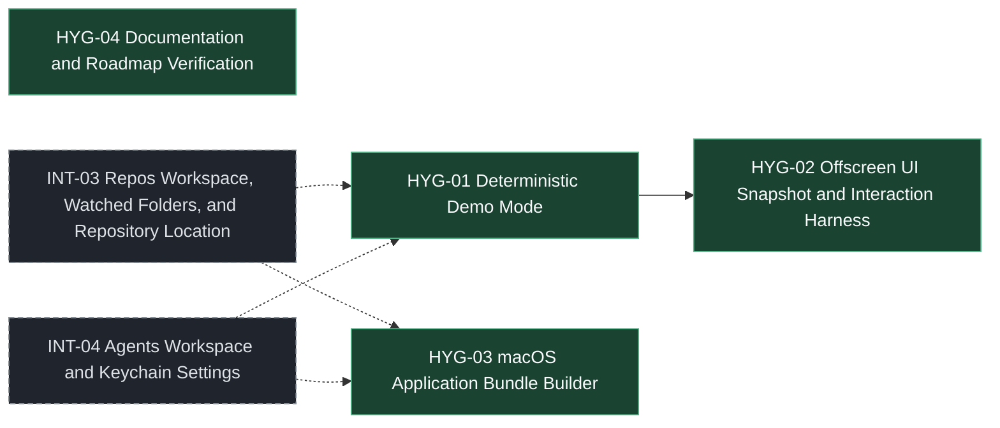

<!-- Generated by roadmap/build.py from roadmap/*.yml. Do not edit by hand. -->

# Roadmap

This page lists every product feature of Astrolabe across five pillars.
Each feature has a status of Shipped or Planned and lists its direct dependencies.
The dependency graphs show how planned features build on shipped foundations across pillars.

## Registry Overview

The registry tracks 30 features and 45 dependency edges across 5 pillars.

### Status Counts

| Status | Count | Meaning |
| --- | ---: | --- |
| Shipped | 15 | Astrolabe includes this feature in the current application. |
| Planned | 15 | Astrolabe schedules this feature for a future release. |

### Pillar Breakdown

| Pillar | Prefix | Total | Shipped | Planned |
| --- | --- | ---: | ---: | ---: |
| [Observe](#observe) | `OBS` | 9 | 6 | 3 |
| [Items](#items) | `ITM` | 4 | 1 | 3 |
| [Runs](#runs) | `RUN` | 5 | 0 | 5 |
| [Interface](#interface) | `INT` | 8 | 4 | 4 |
| [Hygiene](#hygiene) | `HYG` | 4 | 4 | 0 |

## Observe

This pillar tracks live state across local repositories, GitHub accounts, AI provider quotas, local models, and host resources.

| ID | Feature | Status | Priority | Depends On | Docs | Summary |
| --- | --- | --- | --- | --- | --- | --- |
| `OBS-01` | Repository Discovery and Live Watch | Shipped | Core | None | [`repos.md`](../apps/repos.md) | Read-only discovery finds Git repositories under watched folders, tracks file changes live, applies skip rules, and imports saved folder settings on first launch. |
| `OBS-02` | Local Git and Remote Status Engine | Shipped | Core | `OBS-01` | [`repos.md`](../apps/repos.md) | Background workers inspect branches, uncommitted files, stashes, worktrees, submodules, remote divergence, GitHub visibility, account repository lists, and Repository Location state. |
| `OBS-03` | CLI Quota and Probe Runner | Shipped | Core | None | [`agents.md`](../apps/agents.md) | An isolated PTY runner reads usage screens for Claude, Kimi, and Antigravity and parses Codex rollout limits from local session files. |
| `OBS-04` | Provider Quota API Adapters | Shipped | Core | None | [`agents.md`](../apps/agents.md) | Read-only HTTP adapters fetch account quotas and credit balances for GLM, ZCode, Mistral, MiniMax, DeepSeek, and Xiaomi with macOS Keychain keys. |
| `OBS-05` | Local Ollama Memory Monitor | Shipped | Core | None | [`agents.md`](../apps/agents.md) | A five-second poller reads loaded Ollama models, GPU residency, memory pressure, and KV cache estimates with a ten-minute timeline. |
| `OBS-06` | Installed Agent Tool Discovery | Shipped | Supporting | None | [`agents.md`](../apps/agents.md) | Background discovery detects local agent CLIs and desktop apps, checks tool versions and sign-in state, and loads native or bundled icons. |
| `OBS-07` | GitHub Observation | Planned | Core | `OBS-02` | None | A GitHub observer tracks pull requests, review state, open issues, workflow runs, and release checks across tracked repositories. |
| `OBS-08` | Machine Resource Telemetry | Planned | Core | `OBS-05`, `RUN-03`, `RUN-05` | None | Host telemetry measures physical memory, CPU load, GPU pressure, active Linux VMs, and remote host health for capacity views. |
| `OBS-09` | Remote Host Observation | Planned | Core | `OBS-02`, `OBS-05`, `RUN-05` | None | Remote observers stream live repository, local model, and process state from connected Linux and macOS hosts into Astrolabe. |

## Items

This pillar organizes repositories, documents, notes, media assets, and cross-application collections through local query engines and indexes.

| ID | Feature | Status | Priority | Depends On | Docs | Summary |
| --- | --- | --- | --- | --- | --- | --- |
| `ITM-01` | Repository Query, Tag, and Smart Folder Engine | Shipped | Core | `OBS-02` | [`repos.md`](../apps/repos.md) | A TOML store manages automatic and manual tags, nested folders, boolean smart-folder queries, and remote-keyed repository organization. |
| `ITM-02` | Knowledge and Asset Index | Planned | Core | None | None | A rebuildable local SQLite and FTS5 index unifies documents, notes, media assets, page annotations, and cross-application links. |
| `ITM-03` | Reference, Note, and Media Connectors | Planned | Core | `ITM-02`, `RUN-01` | None | Native connectors index Zotero libraries, Markdown note vaults with wiki-link resolution, and media asset libraries while native files stay authoritative. |
| `ITM-04` | Cross-Application Collections | Planned | Core | `ITM-01`, `ITM-03` | None | Workspace collections group repositories, papers, notes, and media assets by content hash and stable identifiers across tools. |

## Runs

This pillar executes background tasks, interactive agents, isolated Linux VMs, supervised workflows, and remote host sessions.

| ID | Feature | Status | Priority | Depends On | Docs | Summary |
| --- | --- | --- | --- | --- | --- | --- |
| `RUN-01` | Background Service | Planned | Core | None | [`architecture.md`](../architecture/architecture.md) | A persistent local daemon runs watchers, index syncs, quota probes, and supervised workflows while the main window stays closed. |
| `RUN-02` | Agent Launcher | Planned | Core | `OBS-02`, `OBS-06`, `RUN-01` | None | The workspace launcher starts interactive or background agents in selected repositories with scoped context and environment presets. |
| `RUN-03` | Managed Linux VMs | Planned | Core | `RUN-01` | None | Astrolabe manages isolated Linux VMs with reproducible images, controlled filesystem mounts, and explicit CPU and memory budgets. |
| `RUN-04` | Agent Workflows in Managed Linux VMs | Planned | Core | `RUN-02`, `RUN-03` | None | Multi-step agent workflows execute inside isolated Linux VMs with automated verification checks and human approval gates before external actions. |
| `RUN-05` | Remote Hosts | Planned | Core | `RUN-01` | None | Encrypted host connections manage remote execution and live sessions across remote Linux and macOS machines. |

## Interface

This pillar provides the shared UI kit, native window shell, current Repos and Agents workspaces, and planned triage views.

| ID | Feature | Status | Priority | Depends On | Docs | Summary |
| --- | --- | --- | --- | --- | --- | --- |
| `INT-01` | Astrolabe Kit | Shipped | Core | None | [`ui-principles.md`](../interface/ui-principles.md) | The shared UI kit provides the mineral palette, typography tokens, shell chrome, data tables, summary tiles, and status chips. |
| `INT-02` | Application Shell and Navigation | Shipped | Core | `INT-01` | [`architecture.md`](../architecture/architecture.md) | The native desktop shell hosts the command bar, sidebar rail, panel switcher, status bar, and keyboard shortcuts. |
| `INT-03` | Repos Workspace, Watched Folders, and Repository Location | Shipped | Core | `INT-02`, `ITM-01` | [`repos.md`](../apps/repos.md) | The Repos workspace provides a three-pane view, location filters, inline watched-folder controls, a repository inspector, and quick IDE, Finder, and Terminal actions. |
| `INT-04` | Agents Workspace and Keychain Settings | Shipped | Core | `INT-02`, `OBS-03`, `OBS-04`, `OBS-05`, `OBS-06` | [`agents.md`](../apps/agents.md) | The Agents workspace displays quota bars, reset timers, an Ollama memory table, installed tools, and a modal for macOS Keychain keys. |
| `INT-05` | Overview | Planned | Core | `INT-06`, `INT-07`, `INT-08` | None | The Overview panel summarizes active repositories, agent runs, quota alerts, and recent knowledge activity in one home view. |
| `INT-06` | Loose Ends | Planned | Core | `INT-03`, `ITM-04`, `OBS-07` | None | The Loose Ends view surfaces uncommitted work, unpushed branches, stale worktrees, and unfinished drafts across tracked projects. |
| `INT-07` | Needs You | Planned | Core | `INT-02`, `OBS-07`, `RUN-04` | None | The Needs You queue collects blocked agent workflows, review checkpoints, and open human decisions in one action list. |
| `INT-08` | Machine | Planned | Core | `INT-04`, `OBS-08`, `OBS-09` | None | The Machine panel displays host memory, Ollama GPU and KV cache usage, active Linux VMs, and remote host capacity. |

## Hygiene

This pillar maintains deterministic demo fixtures, headless UI tests, macOS application bundles, and automated documentation verification.

| ID | Feature | Status | Priority | Depends On | Docs | Summary |
| --- | --- | --- | --- | --- | --- | --- |
| `HYG-01` | Deterministic Demo Mode | Shipped | Supporting | `INT-03`, `INT-04` | [`development-basics.md`](../development/development-basics.md) | The --demo flag loads isolated synthetic snapshots for Repos and Agents without local disk, Keychain, or network access. |
| `HYG-02` | Offscreen UI Snapshot and Interaction Harness | Shipped | Supporting | `HYG-01` | [`development-basics.md`](../development/development-basics.md) | Headless egui\_kittest suites verify keyboard, filter, and panel interactions and render offscreen PNG captures without desktop windows. |
| `HYG-03` | macOS Application Bundle Builder | Shipped | Supporting | `INT-03`, `INT-04` | [`development-basics.md`](../development/development-basics.md) | The bundle script compiles the release binary, generates the application icon, writes Info.plist, and signs Astrolabe.app for macOS. |
| `HYG-04` | Documentation and Roadmap Verification | Shipped | Supporting | None | [`development-basics.md`](../development/development-basics.md) | Automated scripts check documentation headings, validate roadmap schema and dependencies, and run strict MkDocs builds. |
