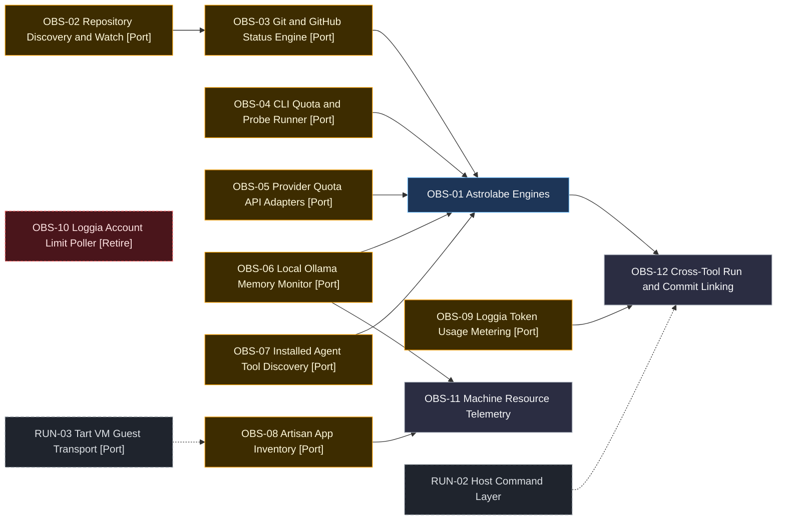
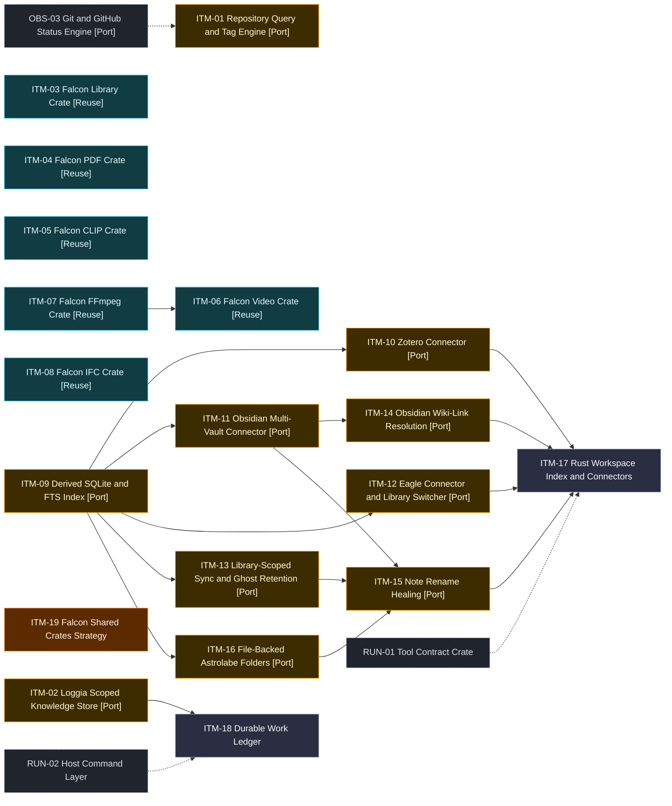
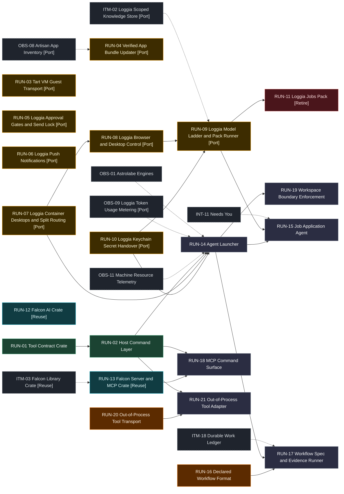
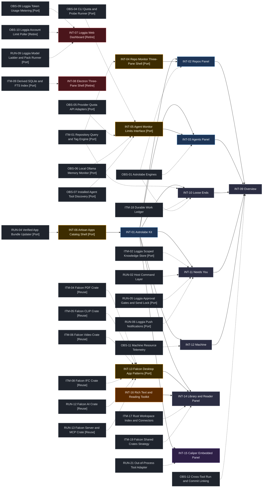
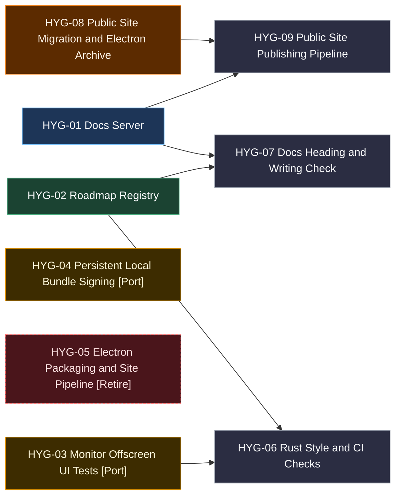

<!-- Generated by roadmap/build.py from roadmap/*.yml. Do not edit by hand. -->

# Roadmap

This page shows every capability in the Astrolabe registry across five pillars.
The registry tracks capabilities from prior repositories, current Astrolabe
foundation crates, planned panels, and open architectural decisions. Each external
capability carries a migration verdict of Port, Reuse, or Retire.

## Registry Overview

The registry holds 77 capabilities and 108 direct dependency edges across 5 pillars.

### Status Counts

| Status | Count | Meaning |
| --- | ---: | --- |
| Shipped | 3 | Code runs on the Astrolabe main branch. |
| Built | 5 | Code lands in the current Astrolabe foundation wave. |
| Existing | 45 | Code runs today in a separate source repository. |
| Planned | 18 | Work sits on the Astrolabe implementation schedule. |
| Idea | 1 | Proposal waits for future evaluation. |
| Decision | 5 | Open choice blocks dependent capabilities. |

### Verdict Counts

| Verdict | Count | Meaning |
| --- | ---: | --- |
| Port | 32 | Rewrite or adapt into Astrolabe crates and panels. |
| Reuse | 8 | Depend on the existing Rust crate directly. |
| Retire | 5 | Replace or drop rather than carry into Astrolabe. |
| Native | 32 | New or native Astrolabe capability. |

### Source Breakdown

| Source | Total | Port | Reuse | Retire | Native |
| --- | ---: | ---: | ---: | ---: | ---: |
| Astrolabe | 32 | 0 | 0 | 0 | 32 |
| Repo Monitor | 5 | 5 | 0 | 0 | 0 |
| Agent Monitor | 6 | 6 | 0 | 0 | 0 |
| Artisan Apps | 4 | 4 | 0 | 0 | 0 |
| Loggia | 11 | 8 | 0 | 3 | 0 |
| Falcon | 9 | 1 | 8 | 0 | 0 |
| Electron Astrolabe | 10 | 8 | 0 | 2 | 0 |

### Pillar Breakdown

| Pillar | Prefix | Total | Shipped | Built | Existing | Planned | Idea | Decision |
| --- | --- | ---: | ---: | ---: | ---: | ---: | ---: | ---: |
| [Observe](#observe) | `OBS` | 12 | 0 | 1 | 9 | 2 | 0 | 0 |
| [Items](#items) | `ITM` | 19 | 0 | 0 | 16 | 2 | 0 | 1 |
| [Runs](#runs) | `RUN` | 21 | 2 | 0 | 11 | 6 | 0 | 2 |
| [Interface](#interface) | `INT` | 16 | 0 | 3 | 6 | 5 | 1 | 1 |
| [Hygiene](#hygiene) | `HYG` | 9 | 1 | 1 | 3 | 3 | 0 | 1 |

## Observe

This pillar tracks live state across local repositories, AI provider accounts, local models, token usage, Artisan VM applications, and machine resources.

| ID | Capability | Status | Scope | Source | Verdict | Depends On | Summary |
| --- | --- | --- | --- | --- | --- | --- | --- |
| `OBS-01` | Astrolabe Engines | Built | Core | Astrolabe (`crates/astrolabe-engines`) | Native | `OBS-03`, `OBS-04`, `OBS-05`, `OBS-06`, `OBS-07` | Shared Rust observation engines unify repository discovery, git and GitHub checks, AI provider quota probes, and local Ollama memory monitors. |
| `OBS-02` | Repository Discovery and Watch | Existing | Core | Repo Monitor (`src/discover.rs`) | Port | None | Recursive read-only discovery finds git repositories under configured roots, tracks filesystem changes live, applies skip rules, and persists manual removals. |
| `OBS-03` | Git and GitHub Status Engine | Existing | Core | Repo Monitor (`src/git.rs`) | Port | `OBS-02` | Background workers inspect branches, uncommitted files, stashes, worktrees, submodules, remote divergence, GitHub visibility, and duplicate clones of one remote. |
| `OBS-04` | CLI Quota and Probe Runner | Existing | Core | Agent Monitor (`src/pty.rs`) | Port | None | An isolated pseudo-terminal runner reads zero-quota usage screens for Claude, Kimi, and Antigravity, Codex rollout limits, and Kimi plan profiles. |
| `OBS-05` | Provider Quota API Adapters | Existing | Core | Agent Monitor (`src/limits/hosted.rs`) | Port | None | Read-only HTTP adapters read account quotas and credit balances for GLM, ZCode, Mistral, MiniMax, DeepSeek, and regional Xiaomi accounts via Keychain keys. |
| `OBS-06` | Local Ollama Memory Monitor | Existing | Core | Agent Monitor (`src/limits/ollama.rs`) | Port | None | A five-second poller reads Ollama models, GPU residency, memory pressure, and estimated KV cache size with context warnings and a ten-minute timeline. |
| `OBS-07` | Installed Agent Tool Discovery | Existing | Supporting | Agent Monitor (`src/agents.rs`) | Port | None | Background discovery detects installed coding CLIs and desktop apps, checks saved sign-in state and tool versions, and loads native or embedded icons. |
| `OBS-08` | Artisan App Inventory | Existing | Supporting | Artisan Apps (`src/check.rs`) | Port | `RUN-03` | Live inventory reads installed Craft and creative apps inside the Artisan VM or locally and checks versions against cached GitHub releases. |
| `OBS-09` | Loggia Token Usage Metering | Existing | Core | Loggia (`usage.py`) | Port | None | A persistent SQLite ledger records token counts from Kimi, GLM, Claude, Codex, and Antigravity logs plus per-agent Ollama metering proxies. |
| `OBS-10` | Loggia Account Limit Poller | Existing | Supporting | Loggia (`limits.py`) | Retire | None | Loggia polls container-side CLI usage screens and Z.ai quotas in Python, and Astrolabe retires it in favor of Agent Monitor engines. |
| `OBS-11` | Machine Resource Telemetry | Planned | Core | Astrolabe | Native | `OBS-06`, `OBS-08` | Native host telemetry tracks physical memory, CPU load, active containers, and Artisan VM health to feed resource budgets and capacity views. |
| `OBS-12` | Cross-Tool Run and Commit Linking | Planned | Core | Astrolabe | Native | `OBS-01`, `OBS-09`, `RUN-02` | Unified observation queries link each agent run with its metered token spend, target repository, branch state, and final git commits. |

## Items

This pillar covers durable local indexes, external library connectors, scoped knowledge stores, asset format crates, and persistent work ledgers.

| ID | Capability | Status | Scope | Source | Verdict | Depends On | Summary |
| --- | --- | --- | --- | --- | --- | --- | --- |
| `ITM-01` | Repository Query and Tag Engine | Existing | Core | Repo Monitor (`src/query.rs`) | Port | `OBS-03` | A TOML organization store provides automatic and manual tags, nested and smart folders keyed by remote, boolean query rules, and aggregate totals. |
| `ITM-02` | Loggia Scoped Knowledge Store | Existing | Core | Loggia (`knowledge.py`) | Port | None | A scoped JSON store manages typed profile facts, an approval inbox for agent questions, evidence-promoted lessons, CLI helpers, and run statistics. |
| `ITM-03` | Falcon Library Crate | Existing | Core | Falcon (`crates/falcon-library`) | Reuse | None | The reusable Rust crate reads and writes Eagle-format libraries with thumbnails, color palettes, metadata parsers, boolean search, smart folders, and undo. |
| `ITM-04` | Falcon PDF Crate | Existing | Core | Falcon (`crates/falcon-pdf`) | Reuse | None | The reusable Rust crate renders PDF pages, extracts text and outlines, controls optional layers, and runs full-document search through PDFKit. |
| `ITM-05` | Falcon CLIP Crate | Existing | Supporting | Falcon (`crates/falcon-clip`) | Reuse | None | The reusable Rust crate computes on-device image and text CLIP embeddings and stores vectors for local semantic search. |
| `ITM-06` | Falcon Video Crate | Existing | Supporting | Falcon (`crates/falcon-video`) | Reuse | `ITM-07` | The reusable Rust crate decodes and plays video through AVFoundation and falls back to FFmpeg when native codecs cannot decode a stream. |
| `ITM-07` | Falcon FFmpeg Crate | Existing | Supporting | Falcon (`crates/falcon-ffmpeg`) | Reuse | None | The reusable Rust crate loads LGPL FFmpeg at run time to decode AV1, MKV, and audio streams with frame synchronization. |
| `ITM-08` | Falcon IFC Crate | Existing | Peripheral | Falcon (`crates/falcon-ifc`) | Reuse | None | The reusable Rust crate extracts full IFC building geometry through an isolated web-ifc worker process. |
| `ITM-09` | Derived SQLite and FTS Index | Existing | Core | Electron Astrolabe (`src/main/db/schema.ts`) | Port | None | A rebuildable local SQLite database with FTS5 indexes documents, source instances, SHA-256 merges, tags, collections, links, and page-anchored annotations. |
| `ITM-10` | Zotero Connector | Existing | Core | Electron Astrolabe (`src/main/connectors/zotero/`) | Port | `ITM-09` | The Zotero connector reads personal and group libraries, collections, tags, PDF attachments, and page-anchored highlights and comments into the index. |
| `ITM-11` | Obsidian Multi-Vault Connector | Existing | Core | Electron Astrolabe (`src/main/connectors/obsidian/`) | Port | `ITM-09` | The Obsidian connector discovers registered vaults automatically, parses frontmatter and inline tags, indexes markdown note bodies, and extracts wiki-links. |
| `ITM-12` | Eagle Connector and Library Switcher | Existing | Core | Electron Astrolabe (`src/main/connectors/eagle/`) | Port | `ITM-09` | The Eagle connector syncs open libraries, lists library history, and coordinates explicit serialized switch-and-sync sweeps across multiple Eagle libraries. |
| `ITM-13` | Library-Scoped Sync and Ghost Retention | Existing | Core | Electron Astrolabe (`src/main/index/removals.ts`) | Port | `ITM-09` | Per-library removal sweeps mark unreachable libraries dormant and keep ghost document records so read history and folder membership survive source deletions. |
| `ITM-14` | Obsidian Wiki-Link Resolution | Existing | Core | Electron Astrolabe (`src/main/index/links.ts`) | Port | `ITM-11` | A post-sync pass resolves note outlinks and backlinks by exact vault path or unique basename and clears ambiguous or stale targets. |
| `ITM-15` | Note Rename Healing | Existing | Core | Electron Astrolabe (`src/main/index/sync.ts`) | Port | `ITM-11`, `ITM-13`, `ITM-16` | Content-hash rename hints pair moved notes safely inside one vault, update instance keys in place, and rewrite folder path references. |
| `ITM-16` | File-Backed Astrolabe Folders | Existing | Core | Electron Astrolabe (`src/main/lib/folders.ts`) | Port | `ITM-09` | Workspace folder files store nested collections with hash-first member references, rebuild a SQLite mirror, and import external collection trees once. |
| `ITM-17` | Rust Workspace Index and Connectors | Planned | Core | Astrolabe | Native | `ITM-10`, `ITM-12`, `ITM-14`, `ITM-15`, `RUN-01` | A native Rust index ports the SQLite and FTS5 schema, Zotero, Obsidian, and Eagle connectors, rename healing, ghost retention, and folders. |
| `ITM-18` | Durable Work Ledger | Planned | Core | Astrolabe | Native | `ITM-02`, `RUN-02` | A durable local ledger persists active tasks, approved specs, decisions, evidence artifacts, and session handoffs across agent restarts and machines. |
| `ITM-19` | Falcon Shared Crates Strategy | Decision | Core | Astrolabe | Native | None | This decision chooses between shared Falcon library crates while Falcon stays standalone or direct Falcon integration as the Astrolabe library tool. |

## Runs

This pillar covers the tool contract, command routing, approval gates, isolated execution environments, workflow orchestration, and agent launch control.

| ID | Capability | Status | Scope | Source | Verdict | Depends On | Summary |
| --- | --- | --- | --- | --- | --- | --- | --- |
| `RUN-01` | Tool Contract Crate | Shipped | Core | Astrolabe (`crates/astrolabe-contract`) | Native | None | The contract crate defines the Tool trait, typed command catalogs with effect levels, structured inspection, rendering, and stable astrolabe item references. |
| `RUN-02` | Host Command Layer | Shipped | Core | Astrolabe (`crates/astrolabe`) | Native | `RUN-01` | The Astrolabe host routes command invocations to registered tools, logs actor-attributed history with undo data, and gates destructive or external actions. |
| `RUN-03` | Tart VM Guest Transport | Existing | Core | Artisan Apps (`src/target.rs`) | Port | None | Host-to-guest transport runs commands inside the Artisan macOS VM through tart exec, stages updater binaries in shared folders, and opens Screen Sharing. |
| `RUN-04` | Verified App Bundle Updater | Existing | Supporting | Artisan Apps (`src/install.rs`) | Port | `OBS-08` | Sequential single and batch updates run Homebrew upgrades, SHA-256 verified GitHub bundle swaps, and ArtCraft Launcher updates and leave active apps untouched. |
| `RUN-05` | Loggia Approval Gates and Send Lock | Existing | Core | Loggia (`approval.py`) | Port | None | Timed approval records hold form snapshots and trigger a recheck before a root-owned browser lock unlocks for one irreversible submission. |
| `RUN-06` | Loggia Push Notifications | Existing | Core | Loggia (`notify.py`) | Port | None | Self-hosted ntfy notifications deliver form screenshots, deep links, and one-tap approve or reject actions to mobile devices over Tailscale. |
| `RUN-07` | Loggia Container Desktops and Split Routing | Existing | Core | Loggia (`net/entrypoint.sh`) | Port | None | Paired Linux XFCE desktop and mihomo router containers separate AI provider traffic from proxied web traffic with kill switches and live allowlists. |
| `RUN-08` | Loggia Browser and Desktop Control | Existing | Core | Loggia (`desktop/page`) | Port | `RUN-07` | Programmatic browser commands and desktop pointer tools share screen coordinates and pause cleanly for human takeover and handback. |
| `RUN-09` | Loggia Model Ladder and Pack Runner | Existing | Core | Loggia (`packrun.py`) | Port | `ITM-02`, `RUN-08`, `RUN-10` | A generic pack runner builds scoped task packets, queues per-agent jobs with attached files, runs independent checks, and escalates across model tiers. |
| `RUN-10` | Loggia Keychain Secret Handover | Existing | Core | Loggia (`secretstore.py`) | Port | None | Keychain-backed credential storage writes only task-required keys into a temporary agent secrets file for one run and removes them immediately afterward. |
| `RUN-11` | Loggia Jobs Pack | Existing | Peripheral | Loggia (`packs/jobs/`) | Retire | `RUN-09` | The legacy Greenhouse dry-run job application pack, policy rules, verifier, and resume script retire in favor of the native Job Application Agent. |
| `RUN-12` | Falcon AI Crate | Existing | Supporting | Falcon (`crates/falcon-ai`) | Reuse | None | The reusable Rust crate manages AI provider settings and keys and exposes one interface for text, structured JSON output, and image input. |
| `RUN-13` | Falcon Server and MCP Crate | Existing | Supporting | Falcon (`crates/falcon-server`) | Reuse | `ITM-03` | The reusable Rust crate provides an Eagle-compatible local HTTP API and an MCP JSON-RPC tool surface over Falcon libraries. |
| `RUN-14` | Agent Launcher | Planned | Core | Astrolabe | Native | `OBS-01`, `OBS-09`, `OBS-11`, `RUN-02`, `RUN-07`, `RUN-10` | The launcher starts local and containerized agent runs, selects providers by live quota capacity, applies workspace boundaries, and enforces resource budgets. |
| `RUN-15` | Job Application Agent | Planned | Core | Astrolabe | Native | `INT-11`, `RUN-09`, `RUN-14` | A native Astrolabe workflow replaces the retired Loggia jobs pack with verified form checks, scoped facts, live observation, and approval-gated submission. |
| `RUN-16` | Declared Workflow Format | Decision | Core | Astrolabe | Native | None | This decision establishes the declared format that carries workflow specs, rules, checks, evidence, and history across local and hosted environments. |
| `RUN-17` | Workflow Spec and Evidence Runner | Planned | Core | Astrolabe | Native | `ITM-18`, `RUN-14`, `RUN-16` | The workflow runner requires an approved spec before execution, enforces durable rules and checks, and attaches diffs, tests, and captures as evidence. |
| `RUN-18` | MCP Command Surface | Planned | Core | Astrolabe | Native | `RUN-02`, `RUN-13` | The host exposes every registered tool command catalog, inspection query, and render endpoint through one local MCP server for external agents. |
| `RUN-19` | Workspace Boundary Enforcement | Planned | Core | Astrolabe | Native | `RUN-14` | Workspace permission policies compile into native configuration and sandbox settings for each coding agent so repository and network rules persist automatically. |
| `RUN-20` | Out-of-Process Tool Transport | Decision | Supporting | Astrolabe | Native | None | This decision confirms the local socket protocol and message format used to connect non-Rust tools such as VectorCraft and Caliper adapters. |
| `RUN-21` | Out-of-Process Tool Adapter | Planned | Supporting | Astrolabe | Native | `RUN-02`, `RUN-20` | A host adapter wraps external control-port processes as standard Astrolabe tools so agents drive them through the unified command catalog. |

## Interface

This pillar covers the shared Rust UI kit, desktop host panels, migrated monitor interfaces, planned workspace views, and retired legacy shells.

| ID | Capability | Status | Scope | Source | Verdict | Depends On | Summary |
| --- | --- | --- | --- | --- | --- | --- | --- |
| `INT-01` | Astrolabe Kit | Built | Core | Astrolabe (`crates/astrolabe-kit`) | Native | `INT-06` | The shared Rust UI kit extracts the Artisan theme, shell chrome, settings store, Keychain helpers, SQLite helpers, and probe primitives into one crate. |
| `INT-02` | Repos Panel | Built | Core | Astrolabe (`crates/astrolabe`) | Native | `INT-01`, `INT-04`, `OBS-01` | The native Repos panel renders repository lists, folders, smart queries, tags, and inspector totals inside Astrolabe on top of shared engines. |
| `INT-03` | Agents Panel | Built | Core | Astrolabe (`crates/astrolabe`) | Native | `INT-01`, `INT-05`, `OBS-01` | The native Agents panel shows live AI subscription quota bars, provider credit balances, Ollama model memory, and Keychain settings inside Astrolabe. |
| `INT-04` | Repo Monitor Three-Pane Shell | Existing | Core | Repo Monitor (`src/ui.rs`) | Port | `ITM-01` | The three-pane sidebar, repository list, inspector, and folder manager provide keyboard shortcuts, drag-and-drop folders, group modes, sort orders, and quick IDE actions. |
| `INT-05` | Agent Monitor Limits Interface | Existing | Core | Agent Monitor (`src/ui/limits.rs`) | Port | `OBS-04`, `OBS-05`, `OBS-06`, `OBS-07` | The Limits and Settings UI displays threshold usage bars, reset countdowns, Ollama GPU and KV cache tables, and provider Keychain forms. |
| `INT-06` | Artisan Apps Catalog Shell | Existing | Supporting | Artisan Apps (`src/ui.rs`) | Port | `RUN-04` | The native egui launcher displays Craft and creative apps with cached icons, active indicators, update status rows, and Artisan UI components. |
| `INT-07` | Loggia Web Dashboard | Existing | Supporting | Loggia (`dashboard/template.html`) | Retire | `OBS-09`, `OBS-10`, `RUN-09` | The mixed HTML and React browser dashboard for desktops, limits, usage, jobs, and knowledge retires as native Astrolabe panels replace it. |
| `INT-08` | Electron Three-Pane Shell | Existing | Supporting | Electron Astrolabe (`src/renderer/src/frame/`) | Retire | `ITM-09` | The legacy Electron and React Rail, River, Detail Panel, and Command-K shell retires as Astrolabe consolidates onto its native Rust host. |
| `INT-09` | Overview | Planned | Core | Astrolabe | Native | `INT-02`, `INT-03`, `INT-10`, `INT-11`, `INT-12`, `OBS-12` | The Overview panel summarizes active agent runs, open approvals, quota pressure, loose ends, machine health, and recent commits in one home view. |
| `INT-10` | Loose Ends | Planned | Core | Astrolabe | Native | `INT-01`, `ITM-01`, `ITM-18`, `OBS-01` | The Loose Ends panel collects uncommitted changes, stale branches, unpushed commits, and abandoned work items across repositories and agent sessions. |
| `INT-11` | Needs You | Planned | Core | Astrolabe | Native | `INT-01`, `ITM-02`, `RUN-02`, `RUN-05`, `RUN-06` | The Needs You panel unites destructive command approvals, open knowledge questions, blocked agent runs, and mobile notification triage in one queue. |
| `INT-12` | Machine | Planned | Core | Astrolabe | Native | `INT-01`, `OBS-11` | The Machine panel presents physical memory, Ollama GPU and KV cache load, active containers, Artisan VM state, and per-run resource budgets. |
| `INT-13` | Falcon Desktop App Patterns | Existing | Supporting | Falcon (`crates/falcon-app`) | Port | `ITM-04`, `ITM-05`, `ITM-06`, `ITM-08`, `RUN-12`, `RUN-13` | Selected asset grid, waterfall layout, media viewer, capture, and inspector patterns port into Astrolabe while Falcon remains a standalone open-source app. |
| `INT-14` | Library and Reader Panel | Planned | Core | Astrolabe | Native | `INT-01`, `INT-13`, `INT-16`, `ITM-17`, `ITM-19` | The Library and Reader panel browses indexed documents, PDFs, notes, and media inside Astrolabe on top of Falcon crates and Rust connectors. |
| `INT-15` | Caliper Embedded Panel | Idea | Peripheral | Astrolabe | Native | `INT-01`, `RUN-21` | An embedded panel hosts live Caliper machine-learning views through libcaliper while Caliper commands join the Astrolabe tool catalog. |
| `INT-16` | Rich Text and Reading Toolkit | Decision | Core | Astrolabe | Native | None | This decision selects how egui panes combine with falcon-pdf, native views, or a contained web view for long-form documents and text editors. |

## Hygiene

This pillar covers documentation infrastructure, roadmap checks, local bundle signing, offscreen UI tests, continuous integration, and repository cleanup.

| ID | Capability | Status | Scope | Source | Verdict | Depends On | Summary |
| --- | --- | --- | --- | --- | --- | --- | --- |
| `HYG-01` | Docs Server | Built | Supporting | Astrolabe (`docs/`) | Native | None | A local documentation build and server renders Astrolabe architecture, product direction, and roadmap pages with strict link and anchor checks. |
| `HYG-02` | Roadmap Registry | Shipped | Supporting | Astrolabe (`roadmap/`) | Native | None | YAML pillar files, JSON Schema validation, dependency checks, and a Markdown generator maintain the capability catalog and Mermaid pillar graphs. |
| `HYG-03` | Monitor Offscreen UI Tests | Existing | Supporting | Repo Monitor (`src/ui/snapshots.rs`) | Port | None | Headless egui\_kittest harnesses render deterministic screenshots and verify drag-and-drop, filter, and manager interactions without desktop windows. |
| `HYG-04` | Persistent Local Bundle Signing | Existing | Supporting | Agent Monitor (`scripts/signing.py`) | Port | None | A pinned local macOS signing certificate, atomic bundle installer with rollback, and Launch Services helper preserve Keychain approvals across app rebuilds. |
| `HYG-05` | Electron Packaging and Site Pipeline | Existing | Supporting | Electron Astrolabe (`scripts/release/`) | Retire | None | Legacy Node, pnpm, Electron Builder, and old-repository GitHub Pages scripts retire once the Rust workspace owns site and release automation. |
| `HYG-06` | Rust Style and CI Checks | Planned | Supporting | Astrolabe | Native | `HYG-02`, `HYG-03` | Continuous integration runs rustfmt, clippy, cargo test, headless UI snapshots, and roadmap checks on every pull request. |
| `HYG-07` | Docs Heading and Writing Check | Planned | Supporting | Astrolabe | Native | `HYG-01`, `HYG-02` | An automated script checks every documentation and roadmap heading against declarative Title Case rules and blocks personal paths before merge. |
| `HYG-08` | Public Site Migration and Electron Archive | Decision | Supporting | Astrolabe | Native | None | This decision settles when public website builds move to the Rust repository and when the legacy Electron repository moves to archive status. |
| `HYG-09` | Public Site Publishing Pipeline | Planned | Supporting | Astrolabe | Native | `HYG-01`, `HYG-08` | Automated workflows build and deploy the public landing page and documentation site directly from the Rust Astrolabe repository. |

## Migration Matrix

This table lists every existing capability from external repositories with its assigned verdict.

| Source | ID | Capability | Pillar | Verdict | Location | Summary |
| --- | --- | --- | --- | --- | --- | --- |
| Repo Monitor | `HYG-03` | Monitor Offscreen UI Tests | Hygiene | Port | `src/ui/snapshots.rs` | Headless egui\_kittest harnesses render deterministic screenshots and verify drag-and-drop, filter, and manager interactions without desktop windows. |
| Repo Monitor | `INT-04` | Repo Monitor Three-Pane Shell | Interface | Port | `src/ui.rs` | The three-pane sidebar, repository list, inspector, and folder manager provide keyboard shortcuts, drag-and-drop folders, group modes, sort orders, and quick IDE actions. |
| Repo Monitor | `ITM-01` | Repository Query and Tag Engine | Items | Port | `src/query.rs` | A TOML organization store provides automatic and manual tags, nested and smart folders keyed by remote, boolean query rules, and aggregate totals. |
| Repo Monitor | `OBS-02` | Repository Discovery and Watch | Observe | Port | `src/discover.rs` | Recursive read-only discovery finds git repositories under configured roots, tracks filesystem changes live, applies skip rules, and persists manual removals. |
| Repo Monitor | `OBS-03` | Git and GitHub Status Engine | Observe | Port | `src/git.rs` | Background workers inspect branches, uncommitted files, stashes, worktrees, submodules, remote divergence, GitHub visibility, and duplicate clones of one remote. |
| Agent Monitor | `HYG-04` | Persistent Local Bundle Signing | Hygiene | Port | `scripts/signing.py` | A pinned local macOS signing certificate, atomic bundle installer with rollback, and Launch Services helper preserve Keychain approvals across app rebuilds. |
| Agent Monitor | `INT-05` | Agent Monitor Limits Interface | Interface | Port | `src/ui/limits.rs` | The Limits and Settings UI displays threshold usage bars, reset countdowns, Ollama GPU and KV cache tables, and provider Keychain forms. |
| Agent Monitor | `OBS-04` | CLI Quota and Probe Runner | Observe | Port | `src/pty.rs` | An isolated pseudo-terminal runner reads zero-quota usage screens for Claude, Kimi, and Antigravity, Codex rollout limits, and Kimi plan profiles. |
| Agent Monitor | `OBS-05` | Provider Quota API Adapters | Observe | Port | `src/limits/hosted.rs` | Read-only HTTP adapters read account quotas and credit balances for GLM, ZCode, Mistral, MiniMax, DeepSeek, and regional Xiaomi accounts via Keychain keys. |
| Agent Monitor | `OBS-06` | Local Ollama Memory Monitor | Observe | Port | `src/limits/ollama.rs` | A five-second poller reads Ollama models, GPU residency, memory pressure, and estimated KV cache size with context warnings and a ten-minute timeline. |
| Agent Monitor | `OBS-07` | Installed Agent Tool Discovery | Observe | Port | `src/agents.rs` | Background discovery detects installed coding CLIs and desktop apps, checks saved sign-in state and tool versions, and loads native or embedded icons. |
| Artisan Apps | `INT-06` | Artisan Apps Catalog Shell | Interface | Port | `src/ui.rs` | The native egui launcher displays Craft and creative apps with cached icons, active indicators, update status rows, and Artisan UI components. |
| Artisan Apps | `OBS-08` | Artisan App Inventory | Observe | Port | `src/check.rs` | Live inventory reads installed Craft and creative apps inside the Artisan VM or locally and checks versions against cached GitHub releases. |
| Artisan Apps | `RUN-03` | Tart VM Guest Transport | Runs | Port | `src/target.rs` | Host-to-guest transport runs commands inside the Artisan macOS VM through tart exec, stages updater binaries in shared folders, and opens Screen Sharing. |
| Artisan Apps | `RUN-04` | Verified App Bundle Updater | Runs | Port | `src/install.rs` | Sequential single and batch updates run Homebrew upgrades, SHA-256 verified GitHub bundle swaps, and ArtCraft Launcher updates and leave active apps untouched. |
| Loggia | `INT-07` | Loggia Web Dashboard | Interface | Retire | `dashboard/template.html` | The mixed HTML and React browser dashboard for desktops, limits, usage, jobs, and knowledge retires as native Astrolabe panels replace it. |
| Loggia | `ITM-02` | Loggia Scoped Knowledge Store | Items | Port | `knowledge.py` | A scoped JSON store manages typed profile facts, an approval inbox for agent questions, evidence-promoted lessons, CLI helpers, and run statistics. |
| Loggia | `OBS-09` | Loggia Token Usage Metering | Observe | Port | `usage.py` | A persistent SQLite ledger records token counts from Kimi, GLM, Claude, Codex, and Antigravity logs plus per-agent Ollama metering proxies. |
| Loggia | `OBS-10` | Loggia Account Limit Poller | Observe | Retire | `limits.py` | Loggia polls container-side CLI usage screens and Z.ai quotas in Python, and Astrolabe retires it in favor of Agent Monitor engines. |
| Loggia | `RUN-05` | Loggia Approval Gates and Send Lock | Runs | Port | `approval.py` | Timed approval records hold form snapshots and trigger a recheck before a root-owned browser lock unlocks for one irreversible submission. |
| Loggia | `RUN-06` | Loggia Push Notifications | Runs | Port | `notify.py` | Self-hosted ntfy notifications deliver form screenshots, deep links, and one-tap approve or reject actions to mobile devices over Tailscale. |
| Loggia | `RUN-07` | Loggia Container Desktops and Split Routing | Runs | Port | `net/entrypoint.sh` | Paired Linux XFCE desktop and mihomo router containers separate AI provider traffic from proxied web traffic with kill switches and live allowlists. |
| Loggia | `RUN-08` | Loggia Browser and Desktop Control | Runs | Port | `desktop/page` | Programmatic browser commands and desktop pointer tools share screen coordinates and pause cleanly for human takeover and handback. |
| Loggia | `RUN-09` | Loggia Model Ladder and Pack Runner | Runs | Port | `packrun.py` | A generic pack runner builds scoped task packets, queues per-agent jobs with attached files, runs independent checks, and escalates across model tiers. |
| Loggia | `RUN-10` | Loggia Keychain Secret Handover | Runs | Port | `secretstore.py` | Keychain-backed credential storage writes only task-required keys into a temporary agent secrets file for one run and removes them immediately afterward. |
| Loggia | `RUN-11` | Loggia Jobs Pack | Runs | Retire | `packs/jobs/` | The legacy Greenhouse dry-run job application pack, policy rules, verifier, and resume script retire in favor of the native Job Application Agent. |
| Falcon | `INT-13` | Falcon Desktop App Patterns | Interface | Port | `crates/falcon-app` | Selected asset grid, waterfall layout, media viewer, capture, and inspector patterns port into Astrolabe while Falcon remains a standalone open-source app. |
| Falcon | `ITM-03` | Falcon Library Crate | Items | Reuse | `crates/falcon-library` | The reusable Rust crate reads and writes Eagle-format libraries with thumbnails, color palettes, metadata parsers, boolean search, smart folders, and undo. |
| Falcon | `ITM-04` | Falcon PDF Crate | Items | Reuse | `crates/falcon-pdf` | The reusable Rust crate renders PDF pages, extracts text and outlines, controls optional layers, and runs full-document search through PDFKit. |
| Falcon | `ITM-05` | Falcon CLIP Crate | Items | Reuse | `crates/falcon-clip` | The reusable Rust crate computes on-device image and text CLIP embeddings and stores vectors for local semantic search. |
| Falcon | `ITM-06` | Falcon Video Crate | Items | Reuse | `crates/falcon-video` | The reusable Rust crate decodes and plays video through AVFoundation and falls back to FFmpeg when native codecs cannot decode a stream. |
| Falcon | `ITM-07` | Falcon FFmpeg Crate | Items | Reuse | `crates/falcon-ffmpeg` | The reusable Rust crate loads LGPL FFmpeg at run time to decode AV1, MKV, and audio streams with frame synchronization. |
| Falcon | `ITM-08` | Falcon IFC Crate | Items | Reuse | `crates/falcon-ifc` | The reusable Rust crate extracts full IFC building geometry through an isolated web-ifc worker process. |
| Falcon | `RUN-12` | Falcon AI Crate | Runs | Reuse | `crates/falcon-ai` | The reusable Rust crate manages AI provider settings and keys and exposes one interface for text, structured JSON output, and image input. |
| Falcon | `RUN-13` | Falcon Server and MCP Crate | Runs | Reuse | `crates/falcon-server` | The reusable Rust crate provides an Eagle-compatible local HTTP API and an MCP JSON-RPC tool surface over Falcon libraries. |
| Electron Astrolabe | `HYG-05` | Electron Packaging and Site Pipeline | Hygiene | Retire | `scripts/release/` | Legacy Node, pnpm, Electron Builder, and old-repository GitHub Pages scripts retire once the Rust workspace owns site and release automation. |
| Electron Astrolabe | `INT-08` | Electron Three-Pane Shell | Interface | Retire | `src/renderer/src/frame/` | The legacy Electron and React Rail, River, Detail Panel, and Command-K shell retires as Astrolabe consolidates onto its native Rust host. |
| Electron Astrolabe | `ITM-09` | Derived SQLite and FTS Index | Items | Port | `src/main/db/schema.ts` | A rebuildable local SQLite database with FTS5 indexes documents, source instances, SHA-256 merges, tags, collections, links, and page-anchored annotations. |
| Electron Astrolabe | `ITM-10` | Zotero Connector | Items | Port | `src/main/connectors/zotero/` | The Zotero connector reads personal and group libraries, collections, tags, PDF attachments, and page-anchored highlights and comments into the index. |
| Electron Astrolabe | `ITM-11` | Obsidian Multi-Vault Connector | Items | Port | `src/main/connectors/obsidian/` | The Obsidian connector discovers registered vaults automatically, parses frontmatter and inline tags, indexes markdown note bodies, and extracts wiki-links. |
| Electron Astrolabe | `ITM-12` | Eagle Connector and Library Switcher | Items | Port | `src/main/connectors/eagle/` | The Eagle connector syncs open libraries, lists library history, and coordinates explicit serialized switch-and-sync sweeps across multiple Eagle libraries. |
| Electron Astrolabe | `ITM-13` | Library-Scoped Sync and Ghost Retention | Items | Port | `src/main/index/removals.ts` | Per-library removal sweeps mark unreachable libraries dormant and keep ghost document records so read history and folder membership survive source deletions. |
| Electron Astrolabe | `ITM-14` | Obsidian Wiki-Link Resolution | Items | Port | `src/main/index/links.ts` | A post-sync pass resolves note outlinks and backlinks by exact vault path or unique basename and clears ambiguous or stale targets. |
| Electron Astrolabe | `ITM-15` | Note Rename Healing | Items | Port | `src/main/index/sync.ts` | Content-hash rename hints pair moved notes safely inside one vault, update instance keys in place, and rewrite folder path references. |
| Electron Astrolabe | `ITM-16` | File-Backed Astrolabe Folders | Items | Port | `src/main/lib/folders.ts` | Workspace folder files store nested collections with hash-first member references, rebuild a SQLite mirror, and import external collection trees once. |
